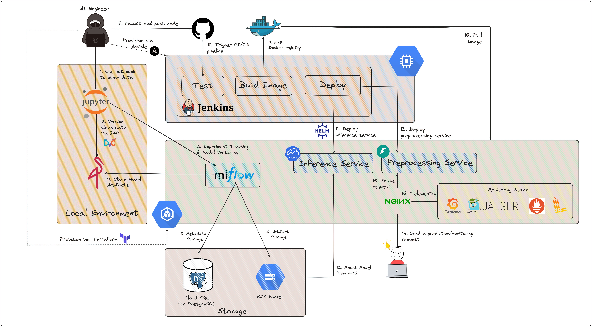
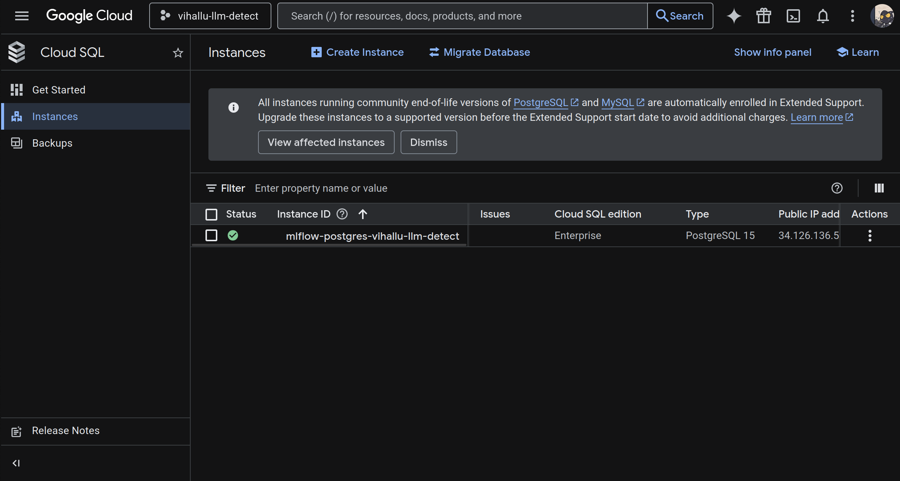
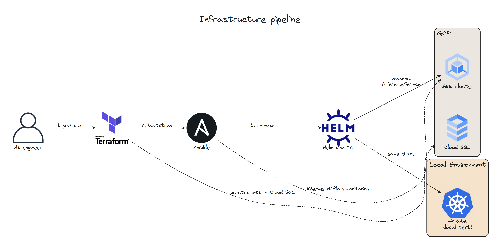
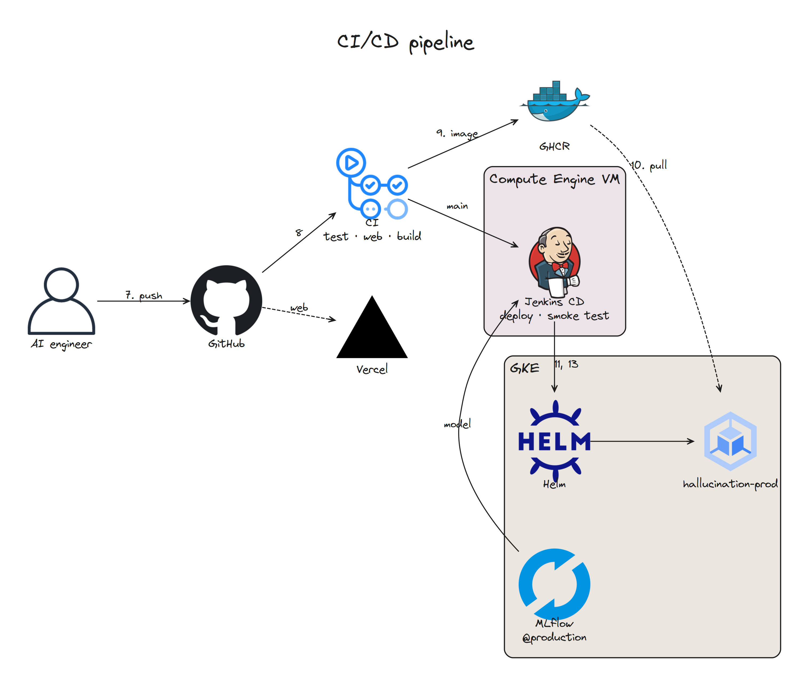
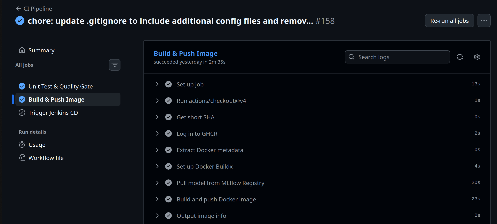
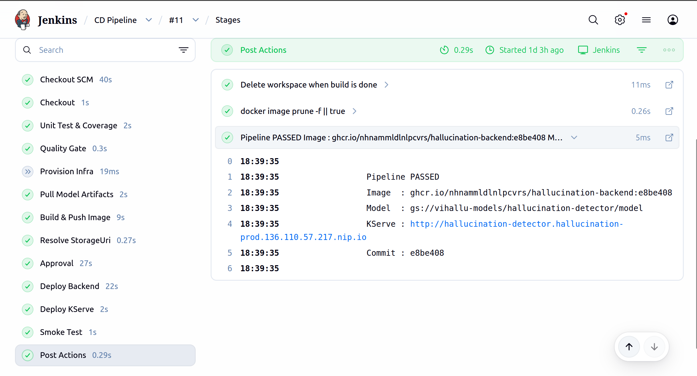
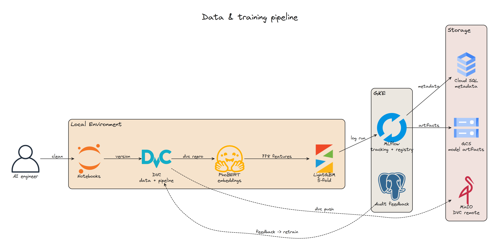
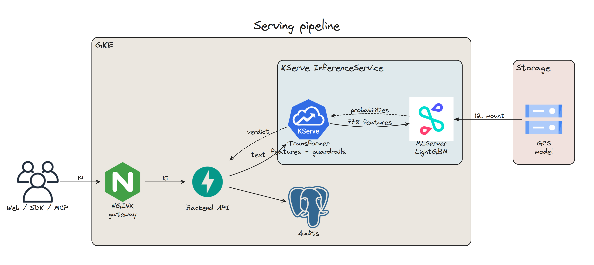
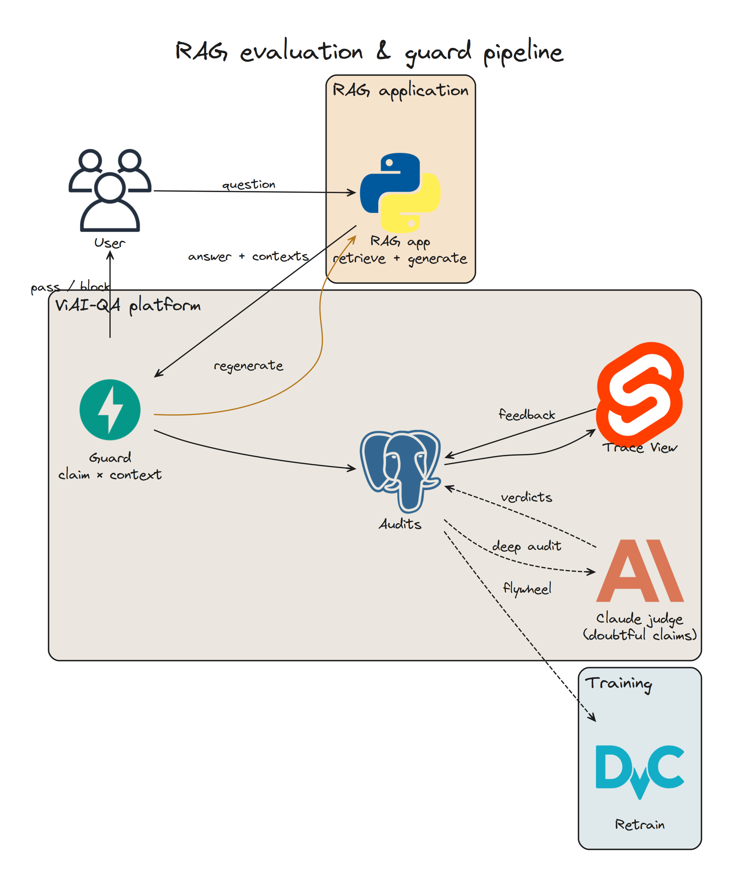
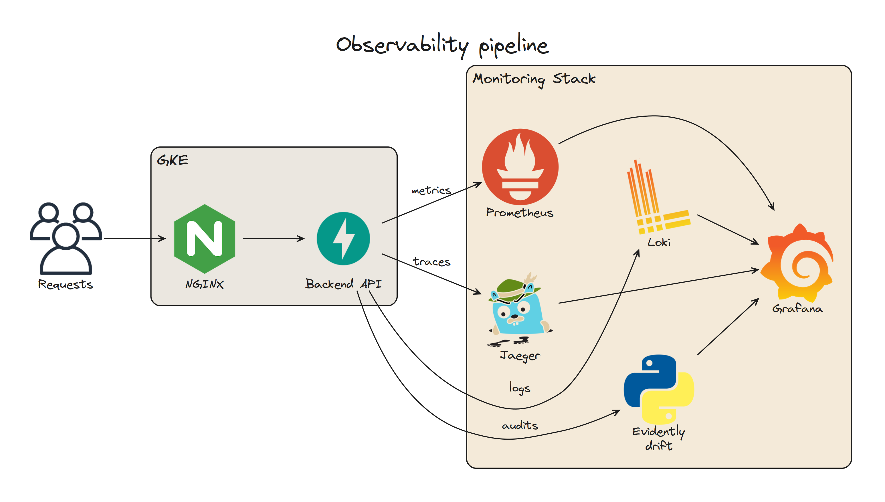

# ViAI-QA: LLM Hallucination Detection for RAG Pipelines

ViAI-QA checks the answers of Vietnamese RAG systems (medical domain) against their retrieved documents. It runs a hybrid detector (PhoBERT, NLI, NER and LLM signals fused into a LightGBM ensemble), an online guard, and a Claude judge agent for doubtful claims.

---

## Table of Contents

- [System Architecture](#system-architecture)

- [Tech Stack](#tech-stack)
- [Introduction](#introduction)
- [Problem Definition](#problem-definition)
- [Repository Structure](#repository-structure)
- [Prerequisites](#prerequisites)
- [Installation & Setup](#installation--setup)
  - [1. Local Development (Docker Compose)](#1-local-development-docker-compose)
  - [2. GKE Deployment (Terraform + Ansible)](#2-gke-deployment-terraform--ansible)
  - [3. CI/CD Pipeline](#3-cicd-pipeline)
- [Model Training](#model-training)
- [API Usage](#api-usage)
- [Monitoring & Observability](#monitoring--observability)
- [Configuration](#configuration)

---

## System Architecture

<p align="center"></p>


| Pipeline | Overview steps | Section |
|---|---|---|
| Data, training and model registry (DVC + MLflow) | 1–6 | [Model Training](#model-training) |
| Infrastructure provisioning and deployment | Terraform / Ansible paths | [GKE Deployment](#2-gke-deployment-terraform--ansible) |
| CI/CD (GitHub Actions → Jenkins) | 7–11, 13 | [CI/CD Pipeline](#3-cicd-pipeline) |
| Serving (API → KServe transformer → MLServer) | 12, 14, 15 | [API Usage](#api-usage) |
| RAG evaluation and guard (medical domain) | platform layer | [API Usage](#api-usage) |
| Observability (metrics, traces, logs, drift) | 16 | [Monitoring & Observability](#monitoring--observability) |
---
## Production Deployment Status

The system has been successfully deployed to Google Cloud production infrastructure.

### Cluster Information

| Property | Value |
|--------|------|
| Cluster | vihallu-cluster |
| Region | asia-southeast1 |
| Node Count | 2 |
| Node Type | e2-standard-4 |
| Kubernetes Version | v1.34 |

### Database Backend

MLflow uses a managed PostgreSQL instance hosted on **Google Cloud SQL**.

| Property | Value |
|--------|------|
| Instance | mlflow-postgres-vihallu-llm-detect |
| Version | PostgreSQL 15 |
| Region | asia-southeast1 |
| Tier | db-f1-micro |
| Storage | SSD |

Cloud SQL console:

<p align="center"></p>

## Tech Stack

| Layer | Technology | Purpose |
|-------|-----------|---------|
| **ML Framework** | PyTorch, HuggingFace Transformers | Model fine-tuning and inference |
| **Backbone Models** | PhoBERT-base, DeBERTa-v3-large, Qwen2.5-1.5B | Embeddings (served model), NLI guardrails, LLM-probability features |
| **NER** | undertheseanlp/vietnamese-ner | Named entity extraction |
| **Ensemble** | LightGBM | Final classification |
| **Judge Agent** | Claude API (`claude-haiku-5-5` by default) | Tier 2 deep audit with tool calling |
| **Agent Integration** | MCP (Python SDK), `viai_qa` client | RAG pipelines and agents call ViAI-QA |
| **Frontend** | SvelteKit, Tailwind CSS | RAG trace view, audits, datasets |
| **Experiment Tracking** | MLflow | Metrics, artifacts, model registry |
| **Data Versioning** | DVC | Dataset & pipeline versioning |
| **Artifact Storage** | MinIO (local) / GCS (production) | Model and data storage |
| **Backend API** | FastAPI, Uvicorn | Pre/post-processing API |
| **API Gateway** | NGINX | Authentication, rate limiting |
| **Containerization** | Docker, Docker Compose | Local development stack |
| **Container Registry** | GitHub Container Registry (GHCR) | Image storage |
| **Kubernetes** | GKE (Google Kubernetes Engine) | Production orchestration |
| **Model Serving** | KServe, MLServer | Scalable model inference |
| **IaC** | Terraform | GKE cluster provisioning |
| **Configuration Mgmt** | Ansible | K8s stack setup |
| **Package Manager** | Helm | K8s application deployment |
| **CI Pipeline** | GitHub Actions | Test, build, push image |
| **CD Pipeline** | Jenkins | Deploy to GKE |
| **Metrics** | Prometheus, Grafana | System & model metrics |
| **Logging** | Loki, Promtail | Centralized log aggregation |
| **Tracing** | Jaeger (OpenTelemetry) | Distributed request tracing |
| **Drift Detection** | Evidently | Data & model drift monitoring |

---

## Introduction

Large Language Models (LLMs) have demonstrated remarkable performance in natural language understanding and generation. However, a critical limitation of these models is **hallucination** — the tendency to generate responses that are fluent and confident but factually incorrect or unsupported by the given context. This problem poses significant risks in real-world applications, especially in **low-resource languages such as Vietnamese**, where high-quality evaluation benchmarks and detection systems remain limited.

This project presents a **Vietnamese Hallucination Detection System** designed to automatically identify and classify hallucinated responses produced by Vietnamese LLMs. The system operates on a structured input triplet consisting of **context**, **prompt**, and **model response**, and predicts whether the response is faithful to the provided context or contains hallucinated information.

## Repository Structure

```
ViAI-qa-llm-hallucination-detection-for-rag-pipeline/
│
├── applications/                                     # Deployable applications
├── machine-learning/                                 # Model lifecycle (run by DVC)
├── data/                                             # Inputs, DVC-tracked
├── artifacts/                                        # DVC outputs and local-only files
├── client-sdk/python/                                # viai_qa client + MCP server
├── infrastructure/                                   # Everything needed to run it
├── tests/                                            # api/  ml/  sdk/  (by component under test)
├── docs/                                             # architecture/  reports/  guides/  images/  + roadmap, refactor plan
├── requirements/                                     # ci, dev, serving, test
├── Jenkinsfile  dvc.yaml  render.yaml  vercel.json   # stay at the root: their tools look for them here
├── pyproject.toml  Makefile                          # pytest config; make test / run / migrate / up / pipeline
└── README.md
```

---

## Prerequisites

| Tool | Version | Purpose |
|------|---------|---------|
| Docker & Docker Compose | ≥ 24.0 | Local development |
| Python | 3.10 | Model training & backend |
| kubectl | ≥ 1.28 | K8s management |
| Helm | ≥ 3.12 | K8s package manager |
| Terraform | ≥ 1.5 | Infrastructure provisioning |
| gcloud CLI | latest | GKE authentication |
| gke-gcloud-auth-plugin | latest | GKE kubectl auth |
| DVC | ≥ 3.0 | Data & pipeline versioning |

---

## Installation & Setup

### 1. Local Development (Docker Compose)

**Clone repository:**
```bash
git clone https://github.com/nghon4maeri/ViAI-qa-llm-hallucination-detection-for-rag-pipeline
cd ViAI-qa-llm-hallucination-detection-for-rag-pipeline
```

**Setup environment:**
```bash
cp infrastructure/iac/terraform/gke/terraform.tfvars.example infrastructure/iac/terraform/gke/terraform.tfvars
# Fill in required values
```

**Start core services (MLflow + MinIO + PostgreSQL):**
```bash
docker compose -f infrastructure/docker-compose.yml up -d minio db
sleep 15
docker compose -f infrastructure/docker-compose.yml up -d mlflow
```

**Verify MLflow is running:**
```bash
curl http://localhost:5000/health # response: OK
```
MLflow UI: `http://localhost:5000` · MinIO UI: `http://localhost:9001` (minioadmin / minioadmin)

**Start backend:**
```bash
docker compose -f infrastructure/docker-compose.yml up -d backend
# Backend available at http://localhost:8080 (Swagger UI at /docs)
```

**Start observability stack:**
```bash
docker compose -f infrastructure/docker-compose.yml up -d prometheus grafana loki promtail jaeger
# Grafana: http://localhost:3000
# Prometheus: http://localhost:9090
# Jaeger: http://localhost:16686
```

**Start NGINX API Gateway:**
```bash
docker compose -f infrastructure/docker-compose.yml up -d nginx-gateway
# API available at http://localhost:80 — requires X-API-Key header
```

### 2. GKE Deployment (Terraform & Ansible)

<p align="center"></p>

Terraform creates the network, GKE cluster, Cloud SQL and secrets. Ansible installs cert-manager, KServe, MLflow and monitoring into the cluster. The Helm releases (by hand or from Jenkins) deploy the backend, the InferenceService, the gateway and the drift service. `deploy-minikube.sh` runs the same chart locally without cloud cost.

**Configure GCP credentials:**
```bash
gcloud auth login
gcloud auth application-default login
gcloud config set project vihallu-llm-detect
```

**Provision GKE cluster:**
```bash
cd infrastructure/iac/terraform/gke
cp terraform.tfvars.example terraform.tfvars
# Fill in project_id, region, zone

terraform init
terraform plan
terraform apply
```

**Connect to cluster:**
```bash
gcloud container clusters get-credentials vihallu-cluster \
  --zone asia-southeast1-a \
  --project vihallu-llm-detect
```

**Local deploy test (minikube, no cloud cost):**
```bash
infrastructure/k8s/local/deploy-minikube.sh     # profile viai-qa; kubectl's default context is not changed
k9s --context viai-qa -n hallucination-prod     # browse pods, InferenceService, logs
kubectl --context viai-qa -n hallucination-prod port-forward svc/hallucination-detector-predictor 18085:80
```
Same chart, runtime and namespace as GKE (`values/model-local.yaml`): KServe 0.16 in Standard mode, the predictor built from `infrastructure/docker/Dockerfile.predictor`, and the model on a PVC instead of S3/GCS. The transformer is off locally, because it needs torch and the NLI/NER weights.

**Deploy KServe + Observability stack:**
```bash
cd infrastructure/iac/ansible
ansible-playbook setup_gke_stack.yaml -v
```

**Upload model to GCS:**
```bash
gsutil mb -l asia-southeast1 gs://vihallu-models
gsutil -m cp -r /path/to/model gs://vihallu-models/hallucination-detector/
gsutil uniformbucketlevelaccess set on gs://vihallu-models
gsutil iam ch allUsers:objectViewer gs://vihallu-models
```

**Deploy InferenceService:**
```bash
kubectl apply -f infrastructure/k8s/runtimes/mlflow-cluster-runtime.yaml
kubectl apply -f infrastructure/k8s/kserve/inference-service.yaml
kubectl get inferenceservice -n hallucination-prod
```

**Deploy Backend via Helm:**
```bash
kubectl apply -f infrastructure/k8s/secrets.yaml

helm upgrade --install hallucination-backend \
  infrastructure/k8s/charts/hallucination-backend \
  --namespace hallucination-prod \
  -f infrastructure/k8s/values/backend-prod.yaml \
  --wait --timeout=10m
```
---

### 3. CI/CD Pipeline

<p align="center"></p>

CI jobs `test`, `web` and `packages` run in parallel; `build` needs all three. On `main`, `trigger-deploy` starts the Jenkins CD stages in order. Vercel builds the web app from git pushes on its own.

**GitHub Actions CI** runs on every push to `feature*` and `main`. **Jenkins CD** is triggered by GitHub Actions after a merge to `main`.

**Setup Jenkins:**
```bash
docker compose -f infrastructure/docker-compose.yml up -d jenkins
docker exec hallucination-jenkins \
  cat /var/jenkins_home/secrets/initialAdminPassword
# Open http://localhost:8080
```

**Required Jenkins credentials:**

| ID | Type | Value |
|----|------|-------|
| `kubeconfig-gke` | Secret file | GKE kubeconfig |
| `ghcr-credentials` | Username/Password | GitHub username + PAT (write:packages) |
| `minio-credentials` | Username/Password | minio / minio123 |

**Required GitHub Secrets:**

| Secret | Value |
|--------|-------|
| `GHCR_TOKEN` | GitHub PAT |
| `MLFLOW_TRACKING_URI` | `http://localhost:5000` |
| `MLFLOW_S3_ENDPOINT_URL` | `http://localhost:9000` |
| `AWS_ACCESS_KEY_ID` | `minio` |
| `AWS_SECRET_ACCESS_KEY` | `minio123` |
| `JENKINS_URL` | `http://<host-ip>:8080` |
| `JENKINS_USER` | `admin` |
| `JENKINS_TOKEN` | Jenkins API token |

**Evidence**

GitHub Actions — CI run passed (an earlier run, before the `web` and `packages` jobs were added):

<p align="center"></p>

Jenkins — CD pipeline, all stages green:

<p align="center"></p>

---

## Model Training

<p align="center"></p>

Notebooks clean the data; DVC versions it and runs the stages below (PhoBERT embeddings → 778 features → 5-fold LightGBM). MLflow keeps the runs and the model registry, with metadata in Cloud SQL and artifacts in GCS. Reviewer feedback from the audit database flows back into retraining.

**Setup environment:**
```bash
conda create -n ai-engineer python=3.10
conda activate ai-engineer
pip install -r requirements.txt
```

**Pull data from DVC remote (MinIO):**
```bash
export AWS_ACCESS_KEY_ID=minio
export AWS_SECRET_ACCESS_KEY=minio123
export MLFLOW_S3_ENDPOINT_URL=http://localhost:9000

dvc pull
```

**Run full training pipeline:**
```bash
dvc repro
```

**Pipeline stages** (`dvc.yaml`, parameters in `machine-learning/params.yaml`):
```
build_medical    data/raw/vimedaqa                 -> data/processed/vimedhallu
embed            data/raw/vihallu                  -> artifacts/features/phobert_embeddings.npy
train            embeddings + vihallu + LLM probs  -> artifacts/models/{lgbm, metadata.yaml, feature_schema.json}  (+ MLflow run)
infer            models + embeddings               -> artifacts/predictions/
export_feedback  audits DB (reviewer feedback)     -> data/processed/feedback
promote          artifacts/models/metadata.yaml    -> MLflow registry alias `production`
```
The stage graph is drawn in the diagram at the top of this section (`dvc dag` prints it in the terminal).

**Model performance (OOF):**
- F1 Score: **0.8634** (v2.1; see [Phase 0 report](docs/reports/PHASE_0_FOUNDATION_FIX_REPORT.md))

- Model: `vihallu-detector` v2.1
- Alias: `production`

**Features** come from one package, `machine-learning/vihallu_features`, which training, batch inference and the API all import, so the 778-feature layout cannot drift between them.

**Check train/serve feature parity and the OOF score** (needs `dvc pull`):
```bash
make test-ml
```

**Promote model to production:**
```bash
python machine-learning/pipelines/promote.py
```
---

## API Usage

<p align="center"></p>

<p align="center"></p>

Requests go through the NGINX gateway to the FastAPI backend. If `KSERVE_ENDPOINT` is set, the detector runs on KServe: the transformer builds the 778 features, the MLServer predictor scores them, and the transformer applies the guardrails. Otherwise the same two steps run in-process.

A RAG application (here `applications/rag-demo`) sends each draft answer to the guard before showing it. `pass` returns it; `regenerate` triggers one retry that lists the unsupported claims; `block` returns a safe fallback. Every call leaves an audit. Doubtful claims can go to the Claude judge agent, and reviewer feedback flows back into training.

**Health check:**
```bash
curl http://localhost:8080/health
```

**Predict hallucination:**
```bash
curl -X POST http://localhost:8080/api/predict \
  -H "Content-Type: application/json" \
  -H "X-API-Key: your-api-key" \
  -d '{
    "context": "Hà Nội là thủ đô của Việt Nam",
    "prompt": "Thủ đô của Việt Nam là gì?",
    "response": "Thủ đô của Việt Nam là Tokyo"
  }'
```

**Response:**
```json
{
  "label": "intrinsic",
  "confidence": 0.996
}
```

**Labels:**
- `intrinsic` — Model contradicts information present in the context

- `extrinsic` — Model introduces information not present in the context
- `none` — No hallucination detected

**Evaluate a RAG turn** (every answer sentence is checked against every retrieved chunk):
```bash
curl -X POST http://localhost:8080/api/v1/audits/rag \
  -H "Content-Type: application/json" \
  -d '{
    "question": "Thủ đô của Việt Nam là gì?",
    "contexts": ["Hà Nội là thủ đô của Việt Nam.", "Việt Nam nằm ở Đông Nam Á."],
    "answer": "Thủ đô của Việt Nam là Hà Nội. Tổng thống Việt Nam sống ở đó."
  }'
```
The response is a normal audit record plus:
- `faithfulness`: share of answer sentences supported by the chunks
- `claims[]`: per sentence, `label`, `confidence`, `context_index` (the supporting chunk) and the NLI/NER `breakdown`
- `rag_metrics`: `context_utilization`, `answer_relevance`, `context_relevance[]` (uncalibrated PhoBERT cosines, compare across runs), and `context_recall` when you send `ground_truth`

RAG audits appear in `GET /api/v1/audits` and accept feedback like any other audit.

**Online guardrail for a RAG pipeline** (call before showing the answer):
```bash
curl -X POST http://localhost:8080/api/v1/audits/rag/guard -H "Content-Type: application/json" \
  -d '{"question": "...", "contexts": ["..."], "answer": "..."}'
# {"action": "pass" | "regenerate" | "block", "reason": "...", "failing_claims": [...], "audit_id": "..."}
```
A Python SDK and an MCP server for Claude Code / Cursor / other agents live in [`client-sdk/python`](client-sdk/python/README.md).

**Deep audit with the Claude judge agent** (Tier 2; needs `ANTHROPIC_API_KEY`):
```bash
curl -X POST "http://localhost:8080/api/v1/audits/<audit_id>/judge?only_doubtful=true"
```
The agent re-checks the sentences Tier 1 was unsure of, using the detector and a dose/number checker as tools, and stores `judge` on the audit: per-sentence verdicts with Vietnamese reasons and evidence, the tool-call trail, and token usage. Estimated cost on the default `claude-haiku-5-5` is about $0.0015 per deep audit; see `docs/IMPROVEMENT_ROADMAP.md` (Phase 2).

**Evaluate a RAG dataset:** upload a `.jsonl` file to `POST /api/v1/batches/upload`, one turn per line:
```json
{"question": "...", "contexts": ["chunk 1", "chunk 2"], "answer": "...", "ground_truth": "optional"}
```
`GET /api/v1/batches/{id}` returns per-item `faithfulness` and `mean_faithfulness`.

**KServe endpoint (GKE):**
```bash
ISVC_URL=http://hallucination-detector.hallucination-prod.136.110.57.217.nip.io

curl $ISVC_URL/v2/health/live
curl $ISVC_URL/v2/models/hallucination-detector

# text in, verdict out: the transformer builds the 778 features, MLServer scores them, guardrails decide
curl -X POST $ISVC_URL/v2/models/hallucination-detector/infer -H 'Content-Type: application/json' -d '{
  "inputs": [{"name": "context",  "datatype": "BYTES", "shape": [1], "data": ["Hà Nội là thủ đô của Việt Nam."]},
             {"name": "prompt",   "datatype": "BYTES", "shape": [1], "data": ["Thủ đô Việt Nam là gì?"]},
             {"name": "response", "datatype": "BYTES", "shape": [1], "data": ["Thủ đô là Hà Nội."]}]}'
# -> outputs: label, confidence, breakdown (JSON)
```
The API uses this endpoint when `KSERVE_ENDPOINT` is set (prod values do); without it the detector runs in-process.

---

## Monitoring & Observability

<p align="center"></p>

The backend exposes Prometheus metrics, sends OpenTelemetry traces to Jaeger and logs to Loki (through Promtail). Audit exports feed the Evidently drift service, and Grafana shows all four.

| Service | Local URL | GKE |
|---------|-----------|-----|
| Grafana | http://localhost:3000 | NodePort |
| Prometheus | http://localhost:9090 | ClusterIP |
| Jaeger | http://localhost:16686 | ClusterIP |
| MLflow | http://localhost:5000 | ClusterIP |
| Evidently | http://localhost:8001 | — |

**Key metrics tracked:**
- Request latency (p50, p95, p99)

- Prediction distribution per label
- Model confidence score distribution
- Data drift (Evidently)
- KServe queue depth and replica count

## Configuration

**Environment variables:**

| Variable | Description | Default |
|----------|-------------|---------|
| `MLFLOW_TRACKING_URI` | MLflow server URL | `http://mlflow:5000` |
| `MLFLOW_MODEL_NAME` | Registered model name | `vihallu-detector` |
| `MLFLOW_MODEL_ALIAS` | Model alias | `production` |
| `MLFLOW_S3_ENDPOINT_URL` | MinIO/S3 endpoint | `http://minio:9000` |
| `AWS_ACCESS_KEY_ID` | MinIO access key | `minio` |
| `AWS_SECRET_ACCESS_KEY` | MinIO secret key | `minio123` |
| `OTEL_EXPORTER_OTLP_ENDPOINT` | Jaeger OTLP endpoint | `http://jaeger:4317` |
| `ANTHROPIC_API_KEY` | Claude API key for the Tier 2 judge agent (read by the SDK) | unset (judge returns 503) |
| `JUDGE_MODEL` / `JUDGE_EFFORT` | Judge model and effort | `claude-haiku-5-5` / `low` (cheapest) |
| `JUDGE_AUTO_ESCALATE` | Run the judge automatically on doubtful RAG audits (paid) | `false` |
| `JUDGE_ESCALATE_BELOW` | Tier 1 confidence below which a claim is doubtful | `0.75` |

**GKE cluster info:**
- Cluster: `vihallu-cluster`

- Region: `asia-southeast1`, Zone: `asia-southeast1-a`
- Node type: `e2-standard-4` (4 vCPU, 16 GB RAM)
- Autoscaling: 1–4 nodes