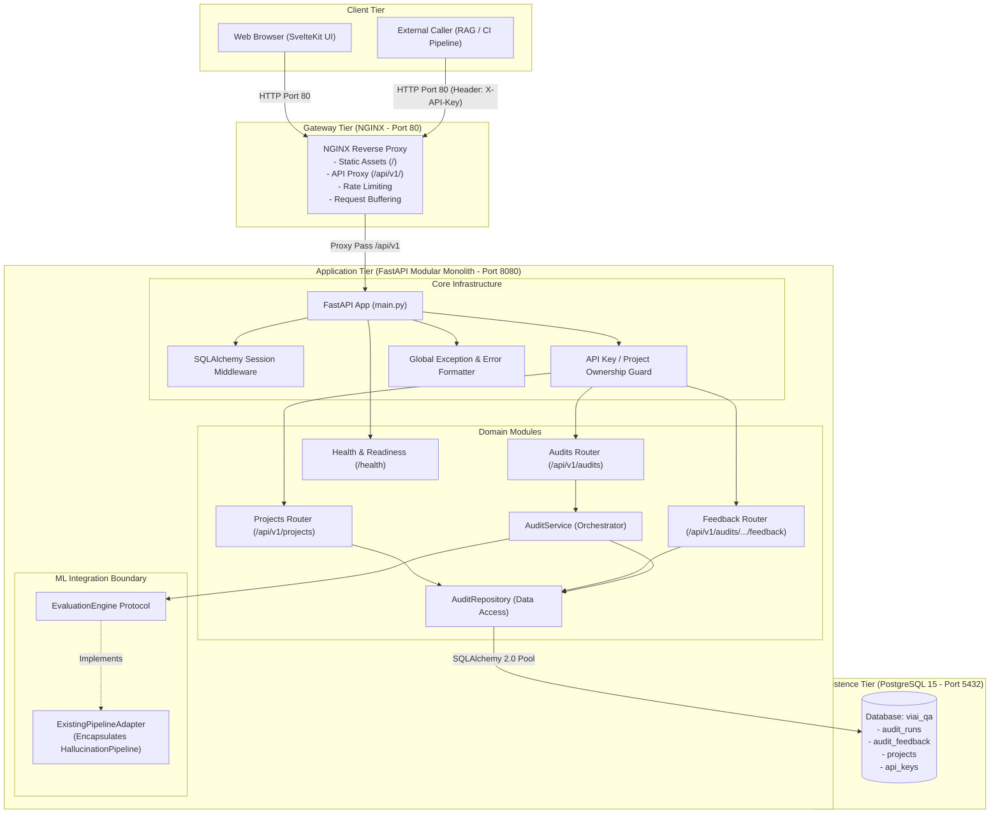
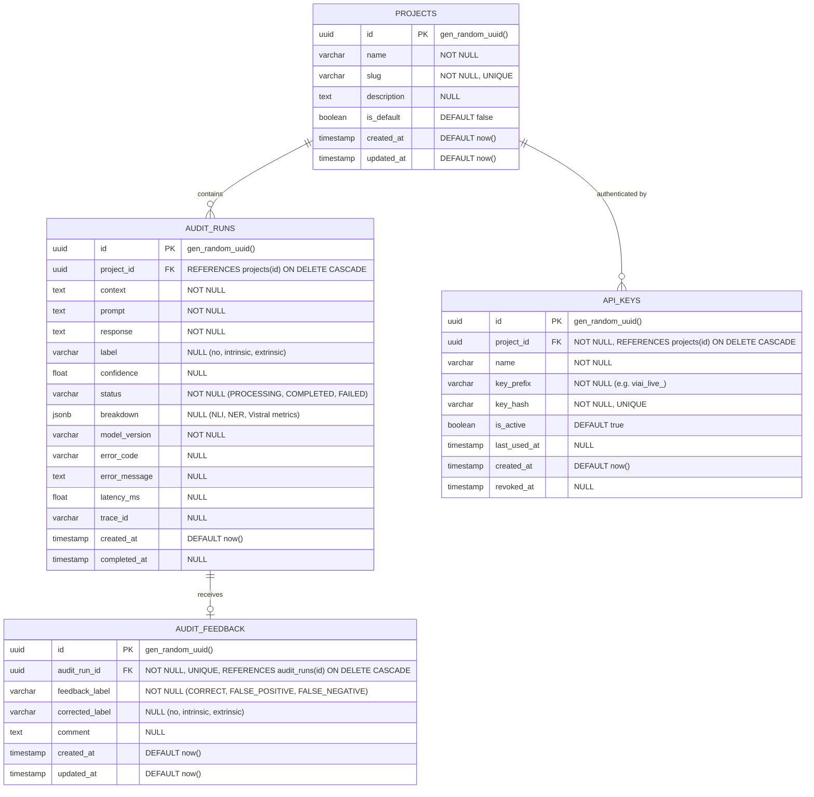
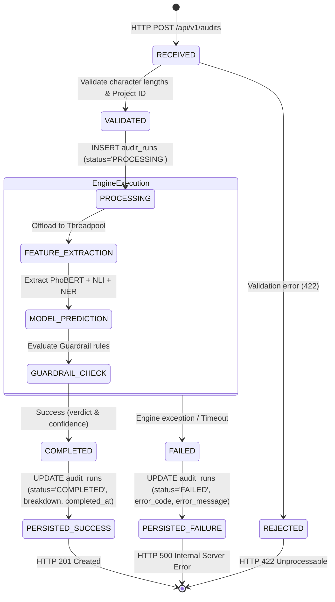
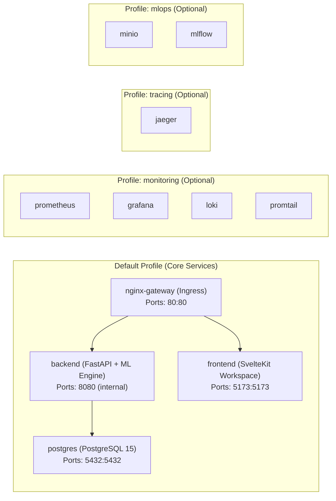

# MVP Technical Architecture Document
## Vietnamese AI Response QA (ViAI-QA)

- **Document Version:** 1.0.0
- **Status:** Architectural Baseline
- **Author:** Principal Software Architect & DevOps Lead

---

## 1. Architecture Overview & Design Principles

The technical architecture for **Vietnamese AI Response QA** transforms an exploratory ML codebase into a dependable, production-ready product workspace. It is guided by four core principles:

1. **Preserve What Works (High ROI ML Reuse)**: Keep the existing multi-signal feature extraction pipeline (PhoBERT, DeBERTa NLI, underthesea NER, and Guardrails) intact, while isolating it behind a strictly typed evaluation adapter.
2. **Modular Monolith First**: Avoid premature microservices, Kafka brokers, or complex worker meshes. The application logic, database persistence, and evaluation adapter run as a cohesive FastAPI service with clear internal domain boundaries.
3. **Stateless API, Persistent Storage**: Remove in-memory state from both frontend stores and backend processes. All audits, project metadata, API keys, and feedback records are durably committed to PostgreSQL with schema migrations managed by Alembic.
4. **Lean Default Runtime**: Provide a lean Docker Compose configuration (PostgreSQL + FastAPI Backend + SvelteKit Frontend + NGINX) for instant local developer onboarding, while keeping heavy MLOps services (MLflow, Prometheus, Jaeger, Loki, Evidently) accessible via optional Compose profiles.

---

## 2. Reusable Component Strategy Matrix

Every existing component in the repository has been audited against source code to determine its role in the MVP:

| Component | Repository Source | Current Responsibility | Proposed MVP Role | Decision | Justification |
|---|---|---|---|---|---|
| **FastAPI Core** | [`backend/main.py`](file:///home/nguyen-nam/User/nghonamjiwoo/vietnamese-llm-hallucination-detection/backend/main.py) | Application entrypoint, OTel, CORS, `/health`, `/metrics` | Core application REST API | **REFACTOR** | Retain FastAPI, add `/api/v1` routers, configure proper error handlers and DB session middleware. |
| **ML Inference Pipeline** | [`backend/model/inference_model.py`](file:///home/nguyen-nam/User/nghonamjiwoo/vietnamese-llm-hallucination-detection/backend/model/inference_model.py) | 342-line in-process pipeline: PhoBERT, DeBERTa, NER, Qwen, LightGBM, Guardrails | Evaluation Engine implementation | **REUSE_WITH_ADAPTER** | Wrap inside `EvaluationEngine` protocol. Decouple direct route calls from model internals. |
| **SvelteKit Frontend** | [`frontend/`](file:///home/nguyen-nam/User/nghonamjiwoo/vietnamese-llm-hallucination-detection/frontend) | Single-page demo UI ("AI Guardian"), in-memory history store | Product Workspace UI | **REFACTOR** | Replace ephemeral Svelte store with API client connecting to persistent history, add Detail view. |
| **PostgreSQL** | [`docker-compose.yml#L41-L59`](file:///home/nguyen-nam/User/nghonamjiwoo/vietnamese-llm-hallucination-detection/docker-compose.yml#L41-L59) | Dedicated to MLflow metadata (`POSTGRES_DB=mlflow`) | Core Application Database | **REFACTOR** | Initialize dedicated `viai_qa` database alongside MLflow or run multi-db init script. |
| **NGINX Gateway** | [`nginx/nginx.conf`](file:///home/nguyen-nam/User/nghonamjiwoo/vietnamese-llm-hallucination-detection/nginx/nginx.conf) | Port 80 reverse proxy, rate limiting, `$http_x_api_key` check | API Gateway & Ingress Router | **REFACTOR** | Route `/api/v1/` to backend, serve frontend static assets, enforce rate limiting, fix bypass. |
| **MLflow Loader** | [`backend/model/mlflow_loader.py`](file:///home/nguyen-nam/User/nghonamjiwoo/vietnamese-llm-hallucination-detection/backend/model/mlflow_loader.py) | Standalone MLflow model downloader (46 lines) | None (Dead code in runtime) | **DISABLE_FROM_DEFAULT_RUNTIME** | Kept in repository for training workflows, but not imported by backend API. |
| **Logger Utility** | [`backend/utils/logger.py`](file:///home/nguyen-nam/User/nghonamjiwoo/vietnamese-llm-hallucination-detection/backend/utils/logger.py) | Redundant loguru helper (7 lines) | None (Dead code) | **REMOVE** | Consolidate logging configuration inside `backend/app/core/logging.py`. |
| **Text Preprocessing** | [`backend/utils/preprocessing.py`](file:///home/nguyen-nam/User/nghonamjiwoo/vietnamese-llm-hallucination-detection/backend/utils/preprocessing.py) | Text cleaning and separator concatenation | Domain text utility | **KEEP** | Clean text functions are valid; use consistently in adapter. |
| **Pydantic Schemas** | [`backend/schemas/`](file:///home/nguyen-nam/User/nghonamjiwoo/vietnamese-llm-hallucination-detection/backend/schemas) | `HalluInput`, `HalluOutput` | Base schemas | **REFACTOR** | Extend to support project IDs, detailed metric breakdowns, timestamps, and error codes. |
| **KServe Adapter** | [`backend/kserve_adapter.py`](file:///home/nguyen-nam/User/nghonamjiwoo/vietnamese-llm-hallucination-detection/backend/kserve_adapter.py) | Model server adapter for KServe v1beta1 | Cloud Serving runtime | **OPTIONAL** | Maintain in repo for GKE production scaling; defer from local MVP runtime. |
| **Prometheus** | [`docker-compose.yml#L134-L153`](file:///home/nguyen-nam/User/nghonamjiwoo/vietnamese-llm-hallucination-detection/docker-compose.yml#L134-L153) | Prometheus v2.48 scraping `/metrics` | Operational monitoring | **OPTIONAL** | Enable under `--profile monitoring`. Default MVP runtime does not require it. |
| **Grafana** | [`docker-compose.yml#L204-L231`](file:///home/nguyen-nam/User/nghonamjiwoo/vietnamese-llm-hallucination-detection/docker-compose.yml#L204-L231) | Grafana 10.2 dashboards (System, Inference, Drift) | Observability dashboards | **OPTIONAL** | Enable under `--profile monitoring`. |
| **Loki & Promtail** | [`docker-compose.yml#L155-L184`](file:///home/nguyen-nam/User/nghonamjiwoo/vietnamese-llm-hallucination-detection/docker-compose.yml#L155-L184) | Centralized container log shipping | Log aggregation | **OPTIONAL** | Enable under `--profile monitoring`. |
| **Jaeger** | [`docker-compose.yml#L185-L203`](file:///home/nguyen-nam/User/nghonamjiwoo/vietnamese-llm-hallucination-detection/docker-compose.yml#L185-L203) | All-in-one OTLP tracing collector | Distributed tracing | **OPTIONAL** | Enable under `--profile tracing`. Backend falls back to console exporter when disabled. |
| **Evidently Drift** | [`observability/evidently/`](file:///home/nguyen-nam/User/nghonamjiwoo/vietnamese-llm-hallucination-detection/observability/evidently) | Drift service checking static prediction CSVs | Live Drift monitoring | **DISABLE_FROM_DEFAULT_RUNTIME** | Defer until real-time prediction streaming is implemented in a future sprint. |
| **Jenkins** | [`docker-compose.yml#L274-L294`](file:///home/nguyen-nam/User/nghonamjiwoo/vietnamese-llm-hallucination-detection/docker-compose.yml#L274-L294) | Jenkins LTS container for GKE CD | CD pipeline | **DISABLE_FROM_DEFAULT_RUNTIME** | Defer from local development; GitHub Actions handles CI tests. |

---

## 3. ML Integration Boundary & Adapter Pattern

### 3.1 The Problem: Tightly Coupled Inference
In the existing codebase at [`backend/routers/predict.py#L4-L16`](file:///home/nguyen-nam/User/nghonamjiwoo/vietnamese-llm-hallucination-detection/backend/routers/predict.py#L4-L16), the route handler directly imports `get_hallu_model()` from `backend.model.inference_model`. This causes:
- Inability to unit-test backend business logic without loading 5GB of PyTorch weights or mocking deep internal methods.
- Tight coupling between HTTP schema and ML execution.
- Silent failure and feature mismatch (`predict_disable_shape_check=True` at [`inference_model.py#L287`](file:///home/nguyen-nam/User/nghonamjiwoo/vietnamese-llm-hallucination-detection/backend/model/inference_model.py#L287)).

### 3.2 Evaluation Engine Boundary
We define a clean domain boundary using Python's `Protocol`:

```python
# backend/app/evaluation/interfaces.py
from typing import Protocol, runtime_checkable
from backend.app.evaluation.schemas import EvaluationInput, EvaluationResult

@runtime_checkable
class EvaluationEngine(Protocol):
    """Abstract interface decoupling business services from ML models."""
    def evaluate(self, payload: EvaluationInput) -> EvaluationResult:
        """Execute hallucination detection and return normalized verdict with explainability metrics."""
        ...
        
    def is_ready(self) -> bool:
        """Report whether underlying weights and models are loaded into memory."""
        ...
        
    def warmup(self) -> None:
        """Trigger lazy loading of model weights."""
        ...
```

### 3.3 Evaluation Schemas
```python
# backend/app/evaluation/schemas.py
from typing import Dict, List, Optional
from pydantic import BaseModel, Field

class EvaluationInput(BaseModel):
    context: str = Field(..., min_length=1, max_length=15000)
    prompt: str = Field(..., min_length=1, max_length=2000)
    response: str = Field(..., min_length=1, max_length=5000)

class EvaluationBreakdown(BaseModel):
    p_entailment: float = Field(..., description="DeBERTa NLI Entailment probability")
    p_neutral: float = Field(..., description="DeBERTa NLI Neutral probability")
    p_contradiction: float = Field(..., description="DeBERTa NLI Contradiction probability")
    new_entity_count: int = Field(..., description="Count of entities in response not in context")
    new_entities: List[str] = Field(default_factory=list, description="Extracted new entity tokens")
    entity_overlap_ratio: float = Field(..., description="NER overlap ratio between context and response")
    vistral_extrinsic_prob: float = Field(..., description="Qwen 1.5B zero-shot extrinsic probability")
    active_guardrail: Optional[str] = Field(None, description="Guardrail rule triggered, if any")

class EvaluationResult(BaseModel):
    label: str = Field(..., description="'no', 'intrinsic', or 'extrinsic'")
    confidence: float = Field(..., ge=0.0, le=1.0)
    breakdown: EvaluationBreakdown
    model_version: str = Field(default="vihallu-v2-hybrid")
```

### 3.4 Handling Feature Alignment & Concurrency
1. **Feature Shape Alignment**:
   In `existing_model.py` adapter, the 783-dimensional vector is documented. In Sprint 1, the adapter encapsulates `HallucinationPipeline` cleanly, extracting `f_nli`, `f_ner`, and `f_vistral` directly so they can be exposed in `EvaluationBreakdown` to provide explainability.
2. **Execution Model**:
   `inference_model.py` runs synchronously on CPU and locks CPU threads during tokenizer and forward passes. In the adapter, CPU-bound execution is offloaded to `starlette.concurrency.run_in_threadpool` or a bounded worker pool to keep FastAPI's async event loop responsive for `/health` and history queries.
3. **Failure Isolation**:
   If transformer inference throws an unhandled exception (e.g., token length overflow, memory limit), the adapter catches the exception, logs structured diagnostics, and raises a typed `InferenceEngineError` which the service layer catches to update the database record to `status="FAILED"`.

---

## 4. High-Level System Architecture



---

## 5. Backend Modular Monolith Structure

To prevent massive refactoring churn while establishing clean architecture, the repository will organize backend code into a clean modular package:

```text
backend/
├── app/
│   ├── __init__.py
│   ├── main.py                          # FastAPI factory, router registration, CORS, middleware
│   │
│   ├── core/                            # Cross-cutting foundational concerns
│   │   ├── config.py                    # Pydantic Settings (DB URLs, paths, security keys)
│   │   ├── database.py                  # SQLAlchemy engine, sessionmaker, get_db dependency
│   │   ├── security.py                  # API key hash verification, header extractors
│   │   ├── logging.py                   # Loguru structured JSON setup with correlation ID
│   │   └── exceptions.py                # Typed application exceptions (NotFound, InferenceError)
│   │
│   ├── models/                          # SQLAlchemy ORM declarative models
│   │   ├── base.py                      # DeclarativeBase, TimestampMixin, UUIDMixin
│   │   ├── project.py                   # ProjectModel
│   │   ├── audit.py                     # AuditRunModel
│   │   ├── feedback.py                  # AuditFeedbackModel
│   │   └── api_key.py                   # ApiKeyModel
│   │
│   ├── evaluation/                      # Decoupled Evaluation Boundary
│   │   ├── interfaces.py                # EvaluationEngine protocol
│   │   ├── schemas.py                   # EvaluationInput, EvaluationResult, EvaluationBreakdown
│   │   └── adapters/
│   │       ├── existing_pipeline.py     # Wraps backend.model.inference_model.HallucinationPipeline
│   │       └── mock_engine.py           # Fast, zero-weight engine for CI unit testing
│   │
│   ├── modules/                         # Business Domain Modules
│   │   ├── audits/
│   │   │   ├── router.py                # POST /api/v1/audits, GET /api/v1/audits, GET /{id}
│   │   │   ├── schemas.py               # AuditCreateRequest, AuditResponse, AuditListResponse
│   │   │   ├── service.py               # Orchestrates lifecycle: Record -> Evaluate -> Update DB
│   │   │   └── repository.py            # Filtered queries, pagination, DB transactions
│   │   │
│   │   ├── projects/
│   │   │   ├── router.py                # GET /api/v1/projects, POST /api/v1/projects
│   │   │   ├── schemas.py               # ProjectCreate, ProjectResponse
│   │   │   └── service.py               # Project CRUD & default project initialization
│   │   │
│   │   └── feedback/
│   │       ├── router.py                # POST /api/v1/audits/{id}/feedback
│   │       ├── schemas.py               # FeedbackCreate, FeedbackResponse
│   │       └── service.py               # Upsert feedback logic
│   │
│   └── observability/
│       ├── metrics.py                   # Prometheus counters and histograms
│       └── tracing.py                   # OpenTelemetry setup
│
├── alembic/                             # Database Migrations
│   ├── env.py
│   ├── script.py.mako
│   └── versions/
│       └── 001_initial_schema.py        # Baseline tables
├── alembic.ini
│
├── model/                               # Unmodified legacy ML code (Isolated)
│   └── inference_model.py               # Reused as engine backend
├── model_store/                         # Local weights
└── tests/
```

---

## 6. Database Design & Entity-Relationship Model

### 6.1 Entity-Relationship Diagram (ERD)



### 6.2 Table Specifications

#### 1. `projects`
- **`id`**: `UUID`, Primary Key, default `gen_random_uuid()`.
- **`name`**: `VARCHAR(100)`, Not Null.
- **`slug`**: `VARCHAR(120)`, Not Null, Unique constraint. Index: `ix_projects_slug`.
- **`description`**: `TEXT`, Nullable.
- **`is_default`**: `BOOLEAN`, Default `false`.

#### 2. `audit_runs`
- **`id`**: `UUID`, Primary Key, default `gen_random_uuid()`.
- **`project_id`**: `UUID`, Foreign Key $\rightarrow$ `projects.id` ON DELETE CASCADE. Not Null.
- **`context`**: `TEXT`, Not Null.
- **`prompt`**: `TEXT`, Not Null.
- **`response`**: `TEXT`, Not Null.
- **`label`**: `VARCHAR(20)`, Nullable (populated upon completion). Allowed: `no`, `intrinsic`, `extrinsic`.
- **`confidence`**: `DOUBLE PRECISION`, Nullable (0.0 to 1.0).
- **`status`**: `VARCHAR(20)`, Not Null, Default `'PROCESSING'`. Allowed: `PROCESSING`, `COMPLETED`, `FAILED`.
- **`breakdown`**: `JSONB`, Nullable. Stores `{p_entail, p_neutral, p_contra, new_entity_count, new_entities, overlap_ratio, vistral_prob, guardrail}`.
- **`model_version`**: `VARCHAR(50)`, Not Null, Default `'vihallu-v2-hybrid'`.
- **`error_code`**: `VARCHAR(50)`, Nullable.
- **`error_message`**: `TEXT`, Nullable.
- **`latency_ms`**: `DOUBLE PRECISION`, Nullable.
- **`trace_id`**: `VARCHAR(64)`, Nullable.
- **`created_at`**: `TIMESTAMP WITH TIME ZONE`, Not Null, Default `NOW()`.
- **`completed_at`**: `TIMESTAMP WITH TIME ZONE`, Nullable.
- **Indexes**:
  - `ix_audit_runs_project_created`: Composite B-tree index on `(project_id, created_at DESC)`.
  - `ix_audit_runs_label`: B-tree index on `label`.
  - `ix_audit_runs_status`: B-tree index on `status`.

#### 3. `audit_feedback`
- **`id`**: `UUID`, Primary Key, default `gen_random_uuid()`.
- **`audit_run_id`**: `UUID`, Foreign Key $\rightarrow$ `audit_runs.id` ON DELETE CASCADE. Not Null, Unique constraint (one feedback per audit).
- **`feedback_label`**: `VARCHAR(30)`, Not Null. Allowed: `CORRECT`, `FALSE_POSITIVE`, `FALSE_NEGATIVE`.
- **`corrected_label`**: `VARCHAR(20)`, Nullable.
- **`comment`**: `TEXT`, Nullable.
- **`created_at`**: `TIMESTAMP WITH TIME ZONE`, Not Null, Default `NOW()`.
- **`updated_at`**: `TIMESTAMP WITH TIME ZONE`, Not Null, Default `NOW()`.

#### 4. `api_keys`
- **`id`**: `UUID`, Primary Key, default `gen_random_uuid()`.
- **`project_id`**: `UUID`, Foreign Key $\rightarrow$ `projects.id` ON DELETE CASCADE. Not Null.
- **`name`**: `VARCHAR(100)`, Not Null.
- **`key_prefix`**: `VARCHAR(16)`, Not Null (e.g., `viai_live_a1b2`).
- **`key_hash`**: `VARCHAR(64)`, Not Null, Unique constraint (SHA-256 hash).
- **`is_active`**: `BOOLEAN`, Default `true`.
- **`last_used_at`**: `TIMESTAMP WITH TIME ZONE`, Nullable.
- **`created_at`**: `TIMESTAMP WITH TIME ZONE`, Default `NOW()`.
- **`revoked_at`**: `TIMESTAMP WITH TIME ZONE`, Nullable.

---

## 7. API Contract & Schemas (Sprint 1 Target)

### 7.1 Endpoints Overview

| Method | Endpoint | Auth | Purpose |
|---|---|---|---|
| `POST` | `/api/v1/audits` | Optional (Uses default project if omitted) | Submit triplet, execute evaluation, persist and return record |
| `GET` | `/api/v1/audits` | Optional | Retrieve paginated audit history with filters |
| `GET` | `/api/v1/audits/{id}` | Optional | Retrieve single audit details and breakdown |
| `POST` | `/api/v1/audits/{id}/feedback` | Optional | Submit human feedback/correction |
| `GET` | `/api/v1/projects` | Optional | List existing projects |
| `POST` | `/api/v1/projects` | Optional | Create a new project |
| `GET` | `/health` | None | Service liveness and DB readiness probe |
| `GET` | `/metrics` | None | Prometheus telemetry metrics |

### 7.2 Request & Response Specifications

#### 1. Submit Single Audit
`POST /api/v1/audits`

**Headers**:
- `Content-Type: application/json`
- `X-API-Key: viai_live_...` (Optional in Sprint 1 local mode)

**Request Body**:
```json
{
  "project_id": "3fa85f64-5717-4562-b3fc-2c963f66afa6",
  "context": "Hà Nội là thủ đô của Việt Nam từ năm 1945.",
  "prompt": "Thủ đô của Việt Nam là gì?",
  "response": "Thủ đô của Việt Nam là Paris."
}
```

**Response Body (201 Created)**:
```json
{
  "id": "e9b1ea51-d1ff-45ba-8cf1-6a91328e8600",
  "project_id": "3fa85f64-5717-4562-b3fc-2c963f66afa6",
  "status": "COMPLETED",
  "label": "intrinsic",
  "confidence": 0.992,
  "breakdown": {
    "p_entailment": 0.003,
    "p_neutral": 0.015,
    "p_contradiction": 0.982,
    "new_entity_count": 1,
    "new_entities": ["Paris"],
    "entity_overlap_ratio": 0.0,
    "vistral_extrinsic_prob": 0.02,
    "active_guardrail": "NLI_CONTRADICTION_OVERRIDE"
  },
  "context": "Hà Nội là thủ đô của Việt Nam từ năm 1945.",
  "prompt": "Thủ đô của Việt Nam là gì?",
  "response": "Thủ đô của Việt Nam là Paris.",
  "model_version": "vihallu-v2-hybrid",
  "latency_ms": 3420.5,
  "created_at": "2026-11-11T14:30:00.000Z",
  "completed_at": "2026-11-11T14:30:03.420Z"
}
```

#### 2. List Audit History
`GET /api/v1/audits?project_id={id}&label=intrinsic&page=1&page_size=20`

**Response Body (200 OK)**:
```json
{
  "items": [
    {
      "id": "e9b1ea51-d1ff-45ba-8cf1-6a91328e8600",
      "project_id": "3fa85f64-5717-4562-b3fc-2c963f66afa6",
      "status": "COMPLETED",
      "label": "intrinsic",
      "confidence": 0.992,
      "prompt": "Thủ đô của Việt Nam là gì?",
      "response": "Thủ đô của Việt Nam là Paris.",
      "has_feedback": false,
      "created_at": "2026-11-11T14:30:00.000Z"
    }
  ],
  "total": 142,
  "page": 1,
  "page_size": 20,
  "total_pages": 8
}
```

#### 3. Standardized Error Response
When validation or processing fails:
```json
{
  "error": {
    "code": "INFERENCE_FAILED",
    "message": "The evaluation engine encountered an internal error during feature extraction.",
    "trace_id": "c8e41761acd448c8b4f7ecf3d6744a6b"
  }
}
```

---

## 8. Audit Execution Lifecycle



---

## 9. Docker Compose Architecture

### 9.1 Minimal MVP Profile (Default)
To ensure immediate startup on local developer machines without downloading gigabytes of optional monitoring tools, Docker Compose is restructured using compose profiles:



### 9.2 Running Commands
- **Minimal Core MVP**:
  ```bash
  docker compose up -d db backend frontend nginx-gateway
  ```
- **With Full Monitoring**:
  ```bash
  docker compose --profile monitoring up -d
  ```

---

## 10. Security & Gateway Integration

1. **Fixing the NGINX Bypass**:
   In [`docker-compose.yml#L106`](file:///home/nguyen-nam/User/nghonamjiwoo/vietnamese-llm-hallucination-detection/docker-compose.yml#L106), the mapping `ports: - "8000:8080"` is removed from the public host interface, binding backend only inside the internal Docker bridge network `ai-network`. All traffic must enter through `nginx-gateway` on port `80`.
2. **Frontend Routing Update**:
   [`frontend/src/lib/api/api.ts#L13`](file:///home/nguyen-nam/User/nghonamjiwoo/vietnamese-llm-hallucination-detection/frontend/src/lib/api/api.ts#L13) is updated to use relative path `/api/v1/audits` or standard environment variable `VITE_API_URL=/api/v1`. NGINX proxies this cleanly to `backend:8080/api/v1/`.
3. **Database Security**:
   Credentials for PostgreSQL are managed via environment variables (`POSTGRES_USER`, `POSTGRES_PASSWORD`, `DATABASE_URL`) with `.env.example` provided. Default hardcoded passwords in production configs are strictly replaced.
