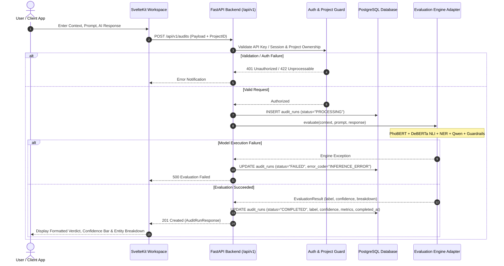
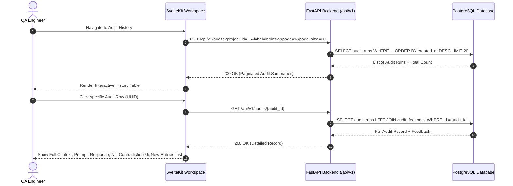
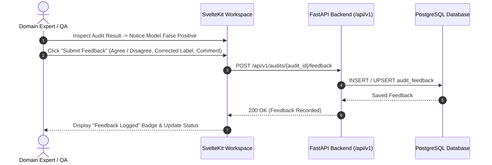
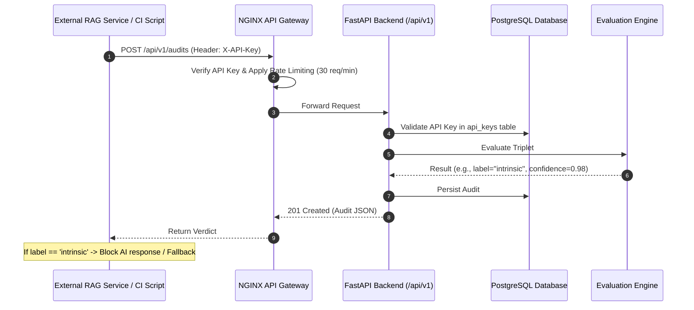

# Product Requirements Document (PRD)
## Vietnamese AI Response QA (ViAI-QA)

- **Document Version:** 1.0.0
- **Status:** Approved for Implementation (Sprint 1)
- **Target Release:** MVP v0.1.0
- **Author:** Principal Software Architect & Product Manager

---

## 1. Executive Summary

### 1.1 Product Vision
**Vietnamese AI Response QA (ViAI-QA)** is a dedicated web workspace and evaluation middleware designed for developers, QA engineers, and enterprise teams building Vietnamese Large Language Model (LLM) and Retrieval-Augmented Generation (RAG) applications. It provides an automated, explainable, and permanent audit trail for AI-generated answers against verified reference contexts, ensuring that hallucinations, direct contradictions, and ungrounded fabrications are detected, recorded, reviewed, and mitigated.

### 1.2 The Problem
Teams developing AI applications in Vietnamese face significant reliability challenges:
1. **Pervasive Hallucination**: Generative LLMs frequently hallucinate facts, alter numbers, or fabricate entities (persons, locations, dates) not present in retrieved context documents.
2. **Lack of Explainable Quality Tools**: Off-the-shelf English evaluation frameworks (RAGAS, TruLens) perform poorly on Vietnamese due to complex morphology, tone marks, and domain-specific Vietnamese entity structures.
3. **Absence of Audit Persistence**: Developers currently test prompts ad-hoc. There is no centralized system of record to store evaluation runs, track regression between prompt iterations, or gather domain expert corrections.
4. **Disconnection Between Development & Production**: Teams have no unified bridge between interactive manual testing (Web UI) and automated regression checking (CI/CD / REST API).

### 1.3 Target Users
1. **Vietnamese RAG / Chatbot Developers**: Need an automated API middleware to evaluate responses before serving them to end users, and an inspection UI to debug prompt/retrieval failures.
2. **QA & Test Engineers**: Need a testbench to input triplets `(context, prompt, response)`, review model confidence, inspect logic contradictions, and export test runs.
3. **Domain Experts / Content Auditors**: Need an interface to review historical AI answers, spot false positives/negatives, and record human feedback to refine future models.

### 1.4 Main Value Proposition
- **Native Vietnamese Hybrid Evaluation**: Reuses fine-tuned PhoBERT semantic embeddings, DeBERTa NLI logical reasoning, Vietnamese Named Entity Recognition (NER), and zero-shot LLM stacking.
- **Explainable Hallucination Taxonomy**: Classifies outputs cleanly into `NO` (Faithful), `INTRINSIC` (Direct contradiction of context), or `EXTRINSIC` (Unverifiable external facts), supplemented by entity difference tracking.
- **Permanent Audit System of Record**: Every evaluation run is assigned a UUID, stored in PostgreSQL, and searchable with complete parameter details.
- **Dual Interface**: Offers an intuitive web UI for exploratory analysis and an authenticated REST API for integration into CI/CD pipelines and production backends.

### 1.5 MVP Objective
The MVP (Sprint 1 to Sprint 2) objective is to establish a robust, reliable, and persistent application foundation that allows a user to submit an audit via Web UI or REST API, execute evaluation through the existing hybrid ML pipeline, permanently persist the audit result in PostgreSQL, inspect detailed logic breakdowns, and retrieve historical audits.

---

## 2. User Personas

### Persona 1: Anh Tuan — Senior AI Engineer (Chatbot & RAG)
- **Role**: Tech Lead building an internal customer support assistant for a Vietnamese fintech enterprise.
- **Goals**: Ensure the AI bot never invents interest rates, terms of service, or loan policies that contradict uploaded PDF guidelines.
- **Pain Points**: Running evaluations manually using Python scripts; no audit trail to prove compliance to business stakeholders; English evaluation tools fail on Vietnamese banking terms.
- **Usage Scenario**: Integrates the `POST /api/v1/audits` API into his RAG retrieval pipeline. Uses the web dashboard to inspect queries that triggered high contradiction scores.

### Persona 2: Linh Chi — QA Lead (AI Testing & Compliance)
- **Role**: Software QA Engineer testing a Vietnamese legal & compliance Q&A chatbot.
- **Goals**: Create standard test suites of 200 question-context pairs, verify the chatbot's answers after every model deployment, and flag ungrounded answers.
- **Pain Points**: Must manually compare long legal contexts against chatbot responses in Excel; results are ephemeral and cannot be shared via URL.
- **Usage Scenario**: Opens the ViAI-QA Web Workspace, inputs the legal context, prompt, and model response, verifies the `INTRINSIC` or `EXTRINSIC` verdict, submits human feedback ("Correct detection"), and exports the audit record.

### Persona 3: Minh Duc — NLP Researcher & Evaluation Specialist
- **Role**: Data Scientist evaluating Vietnamese open-source LLMs (Vistral, PhoGPT, Qwen) on domain datasets.
- **Goals**: Compare hallucination rates across models, analyze entity distortion vs. ungrounded external details, and benchmark performance.
- **Pain Points**: Re-implementing evaluation scripts repeatedly; lacks a unified database to store and filter cross-model comparison results.
- **Usage Scenario**: Uses the Batch Audit feature and REST API to send 500 generated responses, stores them under a designated Project, and reviews confidence distributions.

---

## 3. Product Workflows

### 3.1 Main Audit Execution Workflow


### 3.2 Audit History & Detail Inspection Workflow


### 3.3 Human Feedback & Annotation Workflow


### 3.4 Programmatic External API Integration Workflow (CI/CD / RAG)


---

## 4. Functional Requirements

| ID | Feature Area | Description | Priority | User Story | Acceptance Criteria | Dependencies |
|---|---|---|---|---|---|---|
| **FR-001** | Single Audit Execution | Submit triplet `(context, prompt, response)` for immediate evaluation. | P0 | As an AI developer, I want to submit context, question, and response to detect hallucinations. | 1. Accepts string inputs for context, prompt, response.<br>2. Validates non-empty payloads (trimmed length > 0).<br>3. Returns verdict: `no`, `intrinsic`, `extrinsic`.<br>4. Returns confidence score between 0.0 and 1.0. | Existing ML Adapter |
| **FR-002** | Evaluation Detail Breakdown | Return explainability metrics alongside verdict: NLI probabilities, NER entity diff, and active guardrail. | P0 | As a QA engineer, I want to see why an answer was flagged so I can verify the error. | 1. API response includes `breakdown` with `nli_contradiction`, `nli_neutral`, `nli_entailment`.<br>2. Returns `new_entity_count` and list of identified new entity tokens.<br>3. Indicates if a heuristic guardrail overrode the model. | FR-001 |
| **FR-003** | Persistent Audit Storage | Every executed audit must be stored permanently in PostgreSQL with full execution metadata. | P0 | As an engineer, I want every test run saved to a database so history is not lost on page reload. | 1. Audit record written with UUIDv4 primary key.<br>2. Stores exact context, prompt, response, verdict, confidence, breakdown JSON, timestamps.<br>3. Status transitions from `PROCESSING` to `COMPLETED` or `FAILED`. | PostgreSQL, SQLAlchemy |
| **FR-004** | Audit History Listing | Paginated retrieval of past audits with sorting by creation time. | P0 | As a user, I want to view a table of past audits so I can inspect previous evaluation runs. | 1. Endpoint `GET /api/v1/audits` supports `page` and `page_size` (default 20, max 100).<br>2. Returns total record count, page count, and item summaries.<br>3. Ordered by `created_at` DESC by default. | FR-003 |
| **FR-005** | Audit Detail Retrieval | Fetch complete record of a single audit run by UUID. | P0 | As a user, I want to open a specific audit URL to view complete text and inspect details. | 1. Endpoint `GET /api/v1/audits/{audit_id}` returns full text and scores.<br>2. Returns 404 if UUID does not exist.<br>3. Includes associated human feedback if present. | FR-003 |
| **FR-006** | Project Organization | Group audit runs under Projects to separate applications, models, or environments. | P1 | As a developer, I want to tag audits with a Project so my chatbot tests don't mix with legal QA tests. | 1. System automatically provides a "Default Project".<br>2. User can create new projects via API / UI.<br>3. Audits reference `project_id`.<br>4. History can be filtered by `project_id`. | FR-003 |
| **FR-007** | Search & Filter Audits | Filter audit runs by verdict label, minimum confidence, date range, or keyword search. | P1 | As a QA lead, I want to filter for only `intrinsic` errors so I can review severe hallucinations. | 1. Query parameters support `label` in `[no, intrinsic, extrinsic]`.<br>2. Supports `min_confidence` and `max_confidence`.<br>3. Supports keyword search matching inside prompt or response. | FR-004 |
| **FR-008** | Human Feedback / Annotation | Record human agreement or correction on an automated audit. | P1 | As a domain expert, I want to flag false positives so the team knows the model made a mistake. | 1. Endpoint `POST /api/v1/audits/{audit_id}/feedback`.<br>2. Accepts `feedback_label` (`CORRECT`, `FALSE_POSITIVE`, `FALSE_NEGATIVE`).<br>3. Accepts optional user text comment.<br>4. Persists in `audit_feedback` table. | FR-005 |
| **FR-009** | Export Audit Results | Export filtered audit runs to CSV or JSON for compliance and reporting. | P1 | As a QA lead, I want to export our test results to CSV to attach to release tickets. | 1. Endpoint `GET /api/v1/exports/audits?format=csv|json`.<br>2. Respects active filter parameters (project, label, date).<br>3. CSV includes ID, timestamp, prompt, response, label, confidence, feedback. | FR-004, FR-007 |
| **FR-010** | API Key Authentication | Secure REST API access via Bearer or `X-API-Key` headers for automated clients. | P1 | As a developer, I want an API key so I can call ViAI-QA from my CI/CD pipeline securely. | 1. API keys hashed via SHA-256 in database.<br>2. Endpoints validate key active status.<br>3. Rejects invalid keys with 401 Unauthorized.<br>4. Tracks `last_used_at` timestamp. | FR-003 |
| **FR-011** | Model Warmup & Readiness | Expose explicit warmup endpoint and health readiness probe. | P1 | As a DevOps engineer, I want the system to warm up models before receiving traffic. | 1. Endpoint `POST /api/v1/health/warmup` preloads weights into memory.<br>2. Endpoint `GET /health` reports `status: ok` only when DB and models are ready. | Existing Backend |
| **FR-012** | Batch Audit Processing | Upload CSV containing multiple evaluation triplets for sequential background processing. | P2 | As a researcher, I want to upload 100 test cases and get results without clicking 100 times. | 1. Accepts CSV upload with `context`, `prompt`, `response`.<br>2. Processes items sequentially or via worker queue.<br>3. Updates batch progress.<br>*(Deferred to Sprint 2)* | FR-001, FR-003 |

---

## 5. Non-Functional Requirements (NFR)

### 5.1 Security
- **NFR-SEC-01 (API Key Hashing)**: API keys must never be stored in plaintext. Keys must be generated with at least 256 bits of entropy (e.g. `viai_live_...`) and stored as salted SHA-256 hashes.
- **NFR-SEC-02 (Input Sanitization & Size Limits)**: Maximum payload size for single audit requests must be capped at 1 MB. Context max length: 15,000 characters; prompt: 2,000 characters; response: 5,000 characters. Rejects oversized requests with `413 Payload Too Large`.
- **NFR-SEC-03 (SQL Injection Prevention)**: All database access must use parameterized queries through SQLAlchemy 2.0 ORM / Core. Raw string SQL concatenation is strictly prohibited.
- **NFR-SEC-04 (CORS & Gateway Boundary)**: CORS in backend must restrict allowed origins to the frontend host in production. Direct external exposure of backend port `8080` must be disabled in production profiles, enforcing routing through NGINX.

### 5.2 Performance & Latency
- **NFR-PERF-01 (Inference Latency Baseline)**: On a standard 4-vCPU host without GPU, single evaluation latency must complete within 2.5s to 12.0s. The UI must provide a non-blocking progressive loader.
- **NFR-PERF-02 (Database Query Latency)**: Historical audit listings with pagination and label filtering must return in under 50ms for tables containing up to 100,000 audit records, supported by composite B-tree indexes.
- **NFR-PERF-03 (Worker Concurrency Isolation)**: Because in-process transformer models saturate CPU threads, FastAPI/Uvicorn must be configured with a bounded threadpool or dedicated worker queue to prevent memory thrashing.

### 5.3 Reliability & Data Integrity
- **NFR-REL-01 (Fail-Safe Audit State)**: If model inference crashes, the audit record must transition to `status="FAILED"` with the error message recorded, ensuring no orphaned `PROCESSING` states.
- **NFR-REL-02 (Foreign Key Constraints)**: Audit records must enforce cascade/restrict behaviors on `project_id` and `user_id` to prevent referential corruption.
- **NFR-REL-03 (Transactional Consistency)**: Status updates and feedback logging must execute inside explicit database transactions.

### 5.4 Maintainability & Clean Architecture
- **NFR-MAINT-01 (Decoupled ML Boundary)**: Business logic in routers and services must communicate with the ML pipeline exclusively through an `EvaluationEngine` protocol. No router code may import PyTorch, LightGBM, or Hugging Face directly.
- **NFR-MAINT-02 (Alembic Versioning)**: All database schema evolutions must be tracked through versioned Alembic migration scripts. Automatic `create_all()` in production code is prohibited.

### 5.5 Observability
- **NFR-OBS-01 (Structured Correlation)**: Every request must generate or propagate a `trace_id` recorded in both the database `audit_runs.trace_id` column and the Loguru structured JSON log output.
- **NFR-OBS-02 (Audit Metrics Export)**: Backend must emit Prometheus counters for `viai_audits_total{label="no|intrinsic|extrinsic", project="..."}` and histograms for `viai_audit_duration_seconds`.

---

## 6. MVP Scope Management

```
+--------------------------------------------------------------------------+
|                                MVP SCOPE                                 |
+-----------------------------------+--------------------------------------+
| MUST HAVE (Sprint 1)              | SHOULD HAVE (Sprint 2)               |
| - Single Audit Execution (API)    | - Project Management CRUD            |
| - Persistent Audit Run DB Record  | - Search & Filter (Label, Confidence)|
| - Detailed Explainability Metrics | - Human Feedback Logging             |
| - Audit History Listing Endpoint  | - CSV / JSON Export                  |
| - Single Audit Fetch Endpoint     | - SvelteKit Audit Detail Modal/View  |
| - Evaluation Engine Adapter       | - In-memory API Key Validation       |
| - SQLAlchemy 2.0 + Alembic        | - Refactored SvelteKit History Table |
| - Minimal Docker Compose Profile  |                                      |
+-----------------------------------+--------------------------------------+
| COULD HAVE (Sprint 3)             | WON'T HAVE (Out of Scope for MVP)    |
| - Batch CSV Upload Audit          | - Multi-tenant SaaS Billing/Stripe   |
| - Slack / Webhook Notifications   | - User Signup / Self-serve Org Auth  |
| - Model Regression Compare View   | - LLM Fine-tuning or Model Retraining|
| - Evidently Live Drift Connector  | - Distributed Kubernetes Deployment  |
+-----------------------------------+--------------------------------------+
```

---

## 7. Product Success Metrics

### 7.1 Operational & Reliability Metrics
1. **Audit Persistence Success Rate**: $\ge 99.5\%$ of completed evaluations must be successfully committed to PostgreSQL.
2. **Crash-Free Evaluation Rate**: $\ge 98.0\%$ of valid input triplets complete without uncaught 500 runtime exceptions.
3. **P95 Audit Latency (CPU Baseline)**: P95 latency $\le 10.0$ seconds on 4 vCPU reference hardware.
4. **Historical Query Latency**: P95 query latency for 20-item paginated history $\le 50$ ms.

### 7.2 Product Adoption & Usability Metrics
1. **First Audit Time-to-Value**: A new user starting Docker Compose can execute their first audit in the UI within 3 minutes.
2. **Review & Annotation Rate**: $\ge 15\%$ of audited responses receive human feedback (Agree/Disagree) in testing workflows.
3. **Repeat Audits per Project**: Active projects log an average of $\ge 25$ audits per week.
4. **Export Usage**: $\ge 10\%$ of audit sessions trigger a CSV/JSON report download for regression tracking.
