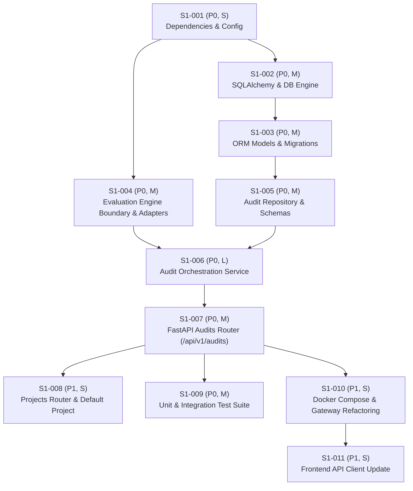

# Sprint 1 Task Backlog
## Vietnamese AI Response QA (ViAI-QA)

- **Sprint Goal**: Establish a reliable application foundation that can evaluate an AI response, persist its result, and retrieve it later.
- **Estimated Duration**: 2 Weeks (assuming 1-2 Full-stack / Backend Engineers)
- **Status**: Ready for Implementation

---

## 1. Task Dependency & Execution Graph

---

## 2. Detailed Task Specifications

### [S1-001] Setup Project Dependencies & Configuration Module
- **Priority**: P0 (Blocker)
- **Complexity**: S
- **Dependencies**: None
- **Files Involved**:
  - `requirements-serving.txt` (Modify)
  - `requirements-ci.txt` (Modify)
  - `backend/app/core/config.py` (Create)
- **Objective**: Add essential database, migration, and configuration libraries to runtime requirements and build the centralized Pydantic settings module.
- **Implementation Steps**:
  1. Append `sqlalchemy>=2.0.25`, `alembic>=1.13.1`, `psycopg2-binary>=2.9.9`, and `pydantic-settings>=2.1.0` to `requirements-serving.txt` and `requirements-ci.txt`.
  2. Create `backend/app/core/config.py` declaring `Settings(BaseSettings)` with:
     - `DATABASE_URL: str = "postgresql://user:password@db:5432/viai_qa"`
     - `ENVIRONMENT: str = "development"`
     - `MODEL_PATH: str = "models/phobert_finetuned_model"`
     - `LGBM_MODEL_PATH: str = "models/lgbm/fold_0.txt"`
     - `API_V1_STR: str = "/api/v1"`
  3. Ensure environment variables can be overridden from `.env` via `model_config = SettingsConfigDict(env_file=".env", extra="ignore")`.
- **Required Tests**:
  - `tests/unit/test_config.py`: Verify that settings parse environment variables correctly and provide default fallbacks.
- **Acceptance Criteria**:
  - `python -c "from backend.app.core.config import settings; print(settings.DATABASE_URL)"` executes without ImportError.
- **Risks**: Version conflict with legacy `mlflow` or `torch` packages; mitigated by pinning compatible minor versions.

---

### [S1-002] Implement Database Connection & Session Management
- **Priority**: P0 (Blocker)
- **Complexity**: M
- **Dependencies**: S1-001
- **Files Involved**:
  - `backend/app/core/database.py` (Create)
  - `docker/init-db.sh` (Create)
  - `docker-compose.yml` (Modify)
- **Objective**: Establish robust PostgreSQL connection pooling, create the application database `viai_qa`, and provide the FastAPI `get_db` dependency.
- **Implementation Steps**:
  1. Create `backend/app/core/database.py` initializing `create_engine` with `pool_pre_ping=True`, `pool_size=10`, `max_overflow=20`.
  2. Implement `SessionLocal = sessionmaker(autocommit=False, autoflush=False, bind=engine)`.
  3. Implement dependency generator `def get_db() -> Generator[Session, None, None]`.
  4. Create `docker/init-db.sh` to ensure PostgreSQL creates both `mlflow` and `viai_qa` databases on fresh startup.
  5. Mount `docker/init-db.sh` into `db` service inside `docker-compose.yml` under `/docker-entrypoint-initdb.d/`.
- **Required Tests**:
  - `tests/unit/test_database.py`: Test `get_db` yielding session and rolling back on unhandled exceptions.
- **Acceptance Criteria**:
  - Backend can acquire a database connection, execute `SELECT 1`, and release connection cleanly back to the pool.
- **Risks**: PostgreSQL connection refusal during cold container boot; handled by `pool_pre_ping=True` and Docker health checks.

---

### [S1-003] Define SQLAlchemy ORM Models & Baseline Alembic Migration
- **Priority**: P0 (Blocker)
- **Complexity**: M
- **Dependencies**: S1-002
- **Files Involved**:
  - `backend/app/models/base.py` (Create)
  - `backend/app/models/project.py` (Create)
  - `backend/app/models/audit.py` (Create)
  - `backend/app/models/feedback.py` (Create)
  - `backend/app/models/api_key.py` (Create)
  - `alembic.ini` (Create)
  - `backend/alembic/env.py` (Create)
  - `backend/alembic/versions/001_initial_schema.py` (Create)
- **Objective**: Model the database entities in SQLAlchemy 2.0 and generate the initial Alembic migration script.
- **Implementation Steps**:
  1. Create `Base` declarative model with UUIDv4 primary keys and timezone-aware timestamps.
  2. Implement `ProjectModel`, `AuditRunModel`, `AuditFeedbackModel`, and `ApiKeyModel`.
  3. Add indexes: `ix_audit_runs_project_created` (composite), `ix_audit_runs_label`, and `ix_audit_runs_status`.
  4. Initialize Alembic configuration pointing to `backend/app/models/base.py`'s `target_metadata`.
  5. Author migration `001_initial_schema.py` creating the 4 tables with foreign keys and cascade rules.
- **Required Tests**:
  - `tests/unit/test_migrations.py`: Run `alembic upgrade head` followed by `alembic downgrade base` against test database.
- **Acceptance Criteria**:
  - Migration executes with 0 errors on PostgreSQL.
  - All foreign key relationships (`audit_runs` $\rightarrow$ `projects`, `audit_feedback` $\rightarrow$ `audit_runs`) are enforced.
- **Risks**: Dialect differences between SQLite (if used in tests) and PostgreSQL (JSONB, UUID); mitigated by using native SQLAlchemy types (`dialects.postgresql.UUID(as_uuid=True)` with fallback).

---

### [S1-004] Build Decoupled Evaluation Boundary & Adapters
- **Priority**: P0 (Blocker)
- **Complexity**: M
- **Dependencies**: S1-001
- **Files Involved**:
  - `backend/app/evaluation/interfaces.py` (Create)
  - `backend/app/evaluation/schemas.py` (Create)
  - `backend/app/evaluation/adapters/existing_pipeline.py` (Create)
  - `backend/app/evaluation/adapters/mock_engine.py` (Create)
- **Objective**: Isolate ML inference behind a typed protocol, wrapping `HallucinationPipeline` while providing a zero-weight mock engine for CI tests.
- **Implementation Steps**:
  1. Create `interfaces.py` declaring `EvaluationEngine(Protocol)` with `evaluate`, `warmup`, and `is_ready`.
  2. Implement `schemas.py` defining `EvaluationInput`, `EvaluationResult`, and `EvaluationBreakdown`.
  3. In `existing_pipeline.py`, encapsulate lazy initialization of `backend.model.inference_model.HallucinationPipeline`. Extract `p_entailment`, `p_neutral`, `p_contradiction`, `new_entity_count`, `new_entities`, `entity_overlap_ratio`, and `vistral_prob` to populate `EvaluationBreakdown`.
  4. In `mock_engine.py`, create a rule-based mock engine (e.g., checks keyword "Paris" or "sai" to return deterministic labels) that requires 0 model weights.
- **Required Tests**:
  - `tests/unit/test_evaluation_adapter.py`: Verify `MockEngine` implements protocol and returns expected `EvaluationResult`.
- **Acceptance Criteria**:
  - Business logic can invoke `engine.evaluate(input)` without directly importing PyTorch or LightGBM.
- **Risks**: Legacy pipeline returns unexpected dictionary keys; mitigated by `raw_result.get(key, default)` in adapter.

---

### [S1-005] Implement Audit Repository & Validation Schemas
- **Priority**: P0 (Blocker)
- **Complexity**: M
- **Dependencies**: S1-003
- **Files Involved**:
  - `backend/app/modules/audits/schemas.py` (Create)
  - `backend/app/modules/audits/repository.py` (Create)
- **Objective**: Create Pydantic input/output schemas for the audit API and implement data access queries with pagination and filtering.
- **Implementation Steps**:
  1. Define `AuditCreateRequest` with length constraints: context (1-15,000 chars), prompt (1-2,000 chars), response (1-5,000 chars).
  2. Define `AuditResponse` and `AuditListResponse` with pagination metadata.
  3. Implement `AuditRepository` methods:
     - `create_pending_audit(...) -> AuditRunModel`
     - `update_completed_audit(...) -> AuditRunModel`
     - `update_failed_audit(...) -> AuditRunModel`
     - `get_by_id(audit_id: UUID) -> Optional[AuditRunModel]`
     - `list_audits(project_id, label, status, skip, limit) -> Tuple[List[AuditRunModel], int]`
     - `get_or_create_default_project() -> UUID`
- **Required Tests**:
  - `tests/unit/test_audit_repository.py`: Verify CRUD operations, pagination slicing, and filter queries.
- **Acceptance Criteria**:
  - Queries execute efficiently with parameterized inputs.
  - Pagination correctly calculates total count and pages.
- **Risks**: N+1 queries when loading feedback; mitigated by using `joinedload(AuditRunModel.feedback)`.

---

### [S1-006] Implement Audit Orchestration Service
- **Priority**: P0 (Blocker)
- **Complexity**: L
- **Dependencies**: S1-004, S1-005
- **Files Involved**:
  - `backend/app/modules/audits/service.py` (Create)
- **Objective**: Coordinate the complete audit lifecycle: record pending state, run inference asynchronously in threadpool, record result or error, and emit metrics.
- **Implementation Steps**:
  1. Inject `AuditRepository` and `EvaluationEngine` into `AuditService`.
  2. Implement `execute_audit(request, trace_id)`:
     - Resolve project ID (default project if none supplied).
     - Commit initial record with `status="PROCESSING"`.
     - Offload `engine.evaluate` to threadpool via `run_in_threadpool`.
     - On success: commit `status="COMPLETED"`, metrics, and latency.
     - On exception: commit `status="FAILED"`, error code, and error message; re-raise for router handler.
  3. Implement `get_audit(audit_id)` and `list_audits(...)`.
- **Required Tests**:
  - `tests/unit/test_audit_service.py`: Test happy path, test inference failure state transition to `FAILED`, test invalid project ID.
- **Acceptance Criteria**:
  - Every audit run is committed before evaluation starts and updated when evaluation concludes.
  - No orphaned `PROCESSING` rows remain if an exception is raised.
- **Risks**: Database transaction deadlocks if connection pool is starved; mitigated by fast, scoped transactions.

---

### [S1-007] Implement FastAPI Audits Router (`/api/v1/audits`)
- **Priority**: P0 (Blocker)
- **Complexity**: M
- **Dependencies**: S1-006
- **Files Involved**:
  - `backend/app/modules/audits/router.py` (Create)
  - `backend/main.py` (Modify)
- **Objective**: Expose standard REST endpoints for submitting audits and retrieving history, mounted under `/api/v1/audits`.
- **Implementation Steps**:
  1. Create router with:
     - `POST /api/v1/audits` (Status 201 Created)
     - `GET /api/v1/audits` (Status 200 OK, paginated)
     - `GET /api/v1/audits/{audit_id}` (Status 200 OK, 404 if missing)
  2. Inject `AuditService` via FastAPI dependency injection.
  3. Extract correlation `trace_id` from request state and pass to service.
  4. In `backend/main.py`, mount router with prefix `/api/v1/audits`.
  5. Add startup event to automatically create default project if missing.
- **Required Tests**:
  - `tests/integration/test_audits_api.py`: Test full API lifecycle with TestClient.
- **Acceptance Criteria**:
  - Valid POST creates record and returns 201 with UUID.
  - Invalid inputs return 422 with descriptive JSON field errors.
  - GET listing returns items matching inserted audit.
- **Risks**: Breaking legacy frontend calling `/api/predict`; mitigated by keeping legacy router active.

---

### [S1-008] Implement Projects Router & Default Workspace
- **Priority**: P1 (Parallelizable)
- **Complexity**: S
- **Dependencies**: S1-003
- **Files Involved**:
  - `backend/app/modules/projects/router.py` (Create)
  - `backend/app/modules/projects/schemas.py` (Create)
  - `backend/app/modules/projects/service.py` (Create)
  - `backend/main.py` (Modify)
- **Objective**: Provide basic project listing and creation endpoints so users can organize evaluation runs.
- **Implementation Steps**:
  1. Implement `GET /api/v1/projects` returning existing projects.
  2. Implement `POST /api/v1/projects` creating a named project with unique slug.
  3. Mount router in `backend/main.py`.
- **Required Tests**:
  - `tests/integration/test_projects_api.py`: Verify project creation and uniqueness validation.
- **Acceptance Criteria**:
  - Returns at least one default project (`Default Workspace`).
- **Risks**: None.

---

### [S1-009] Comprehensive Testing Suite & CI Conformance
- **Priority**: P0 (Blocker)
- **Complexity**: M
- **Dependencies**: S1-007
- **Files Involved**:
  - `tests/conftest.py` (Modify)
  - `tests/unit/test_audit_service.py` (Create)
  - `tests/integration/test_audits_api.py` (Create)
  - `.github/workflows/ci.yml` (Modify)
- **Objective**: Provide automated test coverage for the persistent audit lifecycle and ensure CI runs clean without requiring 5GB model weights.
- **Implementation Steps**:
  1. In `tests/conftest.py`, define `test_db` fixture using in-memory SQLite (or test Postgres) with Alembic migration setup.
  2. Define `mock_engine` fixture and override dependency in FastAPI test app.
  3. Fix legacy integration tests or exclude broken legacy fixtures (`model`, `predict_fn`).
  4. Verify `pytest tests/unit tests/integration` achieves $\ge 80\%$ coverage on all new modules.
- **Required Tests**:
  - All unit and integration tests run in CI container.
- **Acceptance Criteria**:
  - `docker run ... pytest` in CI pipeline completes with green exit code 0 and coverage $>80\%$.
- **Risks**: Discrepancies between SQLite and Postgres in tests; mitigated by keeping SQL queries standard ANSI.

---

### [S1-010] Refactor Docker Compose & Secure NGINX Gateway
- **Priority**: P1 (Parallelizable)
- **Complexity**: S
- **Dependencies**: S1-002, S1-007
- **Files Involved**:
  - `docker-compose.yml` (Modify)
  - `nginx/nginx.conf` (Modify)
- **Objective**: Eliminate direct public access to backend port 8000, route `/api/v1/` through NGINX on port 80, and add Compose profiles for optional services.
- **Implementation Steps**:
  1. In `docker-compose.yml`:
     - Change `backend` port mapping from `8000:8080` to internal exposure only (remove `ports`, keep `expose: ["8080"]`).
     - Add `profiles: ["monitoring"]` to `prometheus`, `grafana`, `loki`, `promtail`.
     - Add `profiles: ["tracing"]` to `jaeger`.
     - Add `profiles: ["mlops"]` to `minio`, `minio-init`, `mlflow`.
  2. In `nginx/nginx.conf`:
     - Route `location /api/v1/` to `http://backend:8080/api/v1/`.
     - Route `location /` to `http://frontend:5173/` (dev) or static root (prod).
     - Maintain rate limiting on `/api/v1/audits` (10r/m, burst 3).
- **Required Tests**:
  - `curl -f http://localhost/health` succeeds via NGINX port 80.
  - `curl -f http://localhost:8000/health` fails / connection refused from outside host.
- **Acceptance Criteria**:
  - Core stack starts with `docker compose up -d db backend frontend nginx-gateway`.
- **Risks**: Dev frontend hot-reload websocket breaking through NGINX; proxy headers (`Upgrade`, `Connection`) configured in `nginx.conf`.

---

### [S1-011] Update Frontend API Client & Remove In-Memory State
- **Priority**: P1
- **Complexity**: S
- **Dependencies**: S1-007, S1-010
- **Files Involved**:
  - `frontend/src/lib/api/api.ts` (Modify)
  - `frontend/src/routes/+layout.svelte` (Modify)
- **Objective**: Connect the SvelteKit frontend to the new `/api/v1/audits` endpoint via NGINX and fix layout syntax bug.
- **Implementation Steps**:
  1. In `frontend/src/routes/+layout.svelte#L3`, remove stray string `clear` after `</script>`.
  2. In `frontend/src/lib/api/api.ts`:
     - Update base URL to `/api/v1/audits`.
     - Add `submitAudit(context, prompt, response, projectId)` returning `AuditResponse`.
     - Add `fetchAuditHistory(page, pageSize, projectId)` calling `GET /api/v1/audits`.
     - Add `fetchAuditDetail(auditId)` calling `GET /api/v1/audits/{auditId}`.
- **Required Tests**:
  - `npm test` or Vitest test in frontend.
- **Acceptance Criteria**:
  - Triggering an audit from the form calls `/api/v1/audits` and displays the saved result.
- **Risks**: None.
