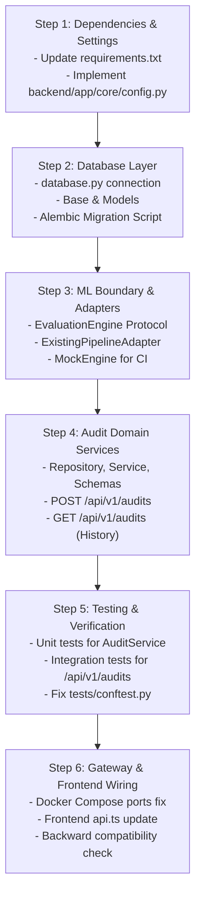

# Sprint 1 Implementation Plan
## Vietnamese AI Response QA (ViAI-QA)

- **Sprint Goal**: Establish a reliable, persistent application foundation that can evaluate an AI response, save the result to PostgreSQL, and retrieve historical audits through an authenticated API.
- **Sprint Target**: MVP Foundation v0.1.0
- **Status**: Ready for Execution

---

## 1. File-Level Repository Mapping

The following matrix specifies the exact modifications, refactoring, and new files required in Sprint 1:

| File Path | Current Status | Proposed Action | Purpose of Change | Dependencies |
|---|---|---|---|---|
| [`backend/main.py`](file:///home/nguyen-nam/User/nghonamjiwoo/vietnamese-llm-hallucination-detection/backend/main.py) | Active | **REFACTOR** | Initialize database tables/migrations on startup, register `/api/v1` routes, configure global exception handlers. | Database Engine, Routers |
| [`backend/app/core/config.py`](file:///home/nguyen-nam/User/nghonamjiwoo/vietnamese-llm-hallucination-detection/backend/app/core/config.py) | None | **CREATE** | Pydantic Settings for DB connection string, security secret keys, model paths, environment. | `pydantic-settings` |
| [`backend/app/core/database.py`](file:///home/nguyen-nam/User/nghonamjiwoo/vietnamese-llm-hallucination-detection/backend/app/core/database.py) | None | **CREATE** | SQLAlchemy 2.0 engine, `sessionmaker`, and FastAPI `get_db` dependency with connection pooling. | `sqlalchemy`, `psycopg2-binary` |
| [`backend/app/models/base.py`](file:///home/nguyen-nam/User/nghonamjiwoo/vietnamese-llm-hallucination-detection/backend/app/models/base.py) | None | **CREATE** | DeclarativeBase, UUID primary key mixin, timestamp mixins (`created_at`, `updated_at`). | `sqlalchemy` |
| [`backend/app/models/project.py`](file:///home/nguyen-nam/User/nghonamjiwoo/vietnamese-llm-hallucination-detection/backend/app/models/project.py) | None | **CREATE** | SQLAlchemy model for `projects` table (supports grouping audits). | `base.py` |
| [`backend/app/models/audit.py`](file:///home/nguyen-nam/User/nghonamjiwoo/vietnamese-llm-hallucination-detection/backend/app/models/audit.py) | None | **CREATE** | SQLAlchemy model for `audit_runs` table with JSONB breakdown and composite indexes. | `base.py`, `project.py` |
| [`backend/app/models/feedback.py`](file:///home/nguyen-nam/User/nghonamjiwoo/vietnamese-llm-hallucination-detection/backend/app/models/feedback.py) | None | **CREATE** | SQLAlchemy model for `audit_feedback` table. | `base.py`, `audit.py` |
| [`backend/app/models/api_key.py`](file:///home/nguyen-nam/User/nghonamjiwoo/vietnamese-llm-hallucination-detection/backend/app/models/api_key.py) | None | **CREATE** | SQLAlchemy model for `api_keys` table with SHA-256 hash storage. | `base.py`, `project.py` |
| [`backend/app/evaluation/interfaces.py`](file:///home/nguyen-nam/User/nghonamjiwoo/vietnamese-llm-hallucination-detection/backend/app/evaluation/interfaces.py) | None | **CREATE** | `EvaluationEngine` protocol decoupling business logic from PyTorch/LightGBM. | Python `typing.Protocol` |
| [`backend/app/evaluation/schemas.py`](file:///home/nguyen-nam/User/nghonamjiwoo/vietnamese-llm-hallucination-detection/backend/app/evaluation/schemas.py) | None | **CREATE** | Typed schemas for `EvaluationInput`, `EvaluationResult`, and `EvaluationBreakdown`. | `pydantic` |
| [`backend/app/evaluation/adapters/existing_pipeline.py`](file:///home/nguyen-nam/User/nghonamjiwoo/vietnamese-llm-hallucination-detection/backend/app/evaluation/adapters/existing_pipeline.py) | None | **CREATE** | Adapter implementing `EvaluationEngine`, wrapping legacy `HallucinationPipeline`. | [`inference_model.py`](file:///home/nguyen-nam/User/nghonamjiwoo/vietnamese-llm-hallucination-detection/backend/model/inference_model.py) |
| [`backend/app/evaluation/adapters/mock_engine.py`](file:///home/nguyen-nam/User/nghonamjiwoo/vietnamese-llm-hallucination-detection/backend/app/evaluation/adapters/mock_engine.py) | None | **CREATE** | Deterministic mock engine for zero-weight CI unit tests and development without models. | `interfaces.py` |
| [`backend/app/modules/audits/schemas.py`](file:///home/nguyen-nam/User/nghonamjiwoo/vietnamese-llm-hallucination-detection/backend/app/modules/audits/schemas.py) | None | **CREATE** | Pydantic request/response schemas for `/api/v1/audits` (validation rules, lengths). | `pydantic` |
| [`backend/app/modules/audits/repository.py`](file:///home/nguyen-nam/User/nghonamjiwoo/vietnamese-llm-hallucination-detection/backend/app/modules/audits/repository.py) | None | **CREATE** | Data access layer for `audit_runs`: create record, update result, paginate history. | `database.py`, `audit.py` |
| [`backend/app/modules/audits/service.py`](file:///home/nguyen-nam/User/nghonamjiwoo/vietnamese-llm-hallucination-detection/backend/app/modules/audits/service.py) | None | **CREATE** | Business orchestrator: create PROCESSING record $\rightarrow$ evaluate $\rightarrow$ update COMPLETED. | `repository.py`, `interfaces.py` |
| [`backend/app/modules/audits/router.py`](file:///home/nguyen-nam/User/nghonamjiwoo/vietnamese-llm-hallucination-detection/backend/app/modules/audits/router.py) | None | **CREATE** | FastAPI endpoints: `POST /`, `GET /`, `GET /{id}`. | `service.py`, `schemas.py` |
| [`backend/app/modules/projects/router.py`](file:///home/nguyen-nam/User/nghonamjiwoo/vietnamese-llm-hallucination-detection/backend/app/modules/projects/router.py) | None | **CREATE** | FastAPI endpoints for listing and creating projects. | `database.py`, `project.py` |
| [`backend/routers/predict.py`](file:///home/nguyen-nam/User/nghonamjiwoo/vietnamese-llm-hallucination-detection/backend/routers/predict.py) | Active | **REFACTOR** | Maintain legacy `/api/predict` as a backward-compatible wrapper calling `AuditService`. | `AuditService` |
| [`backend/model/mlflow_loader.py`](file:///home/nguyen-nam/User/nghonamjiwoo/vietnamese-llm-hallucination-detection/backend/model/mlflow_loader.py) | Active | **DEPRECATE** | Add deprecation notice; decouple from active API execution. | None |
| [`backend/utils/logger.py`](file:///home/nguyen-nam/User/nghonamjiwoo/vietnamese-llm-hallucination-detection/backend/utils/logger.py) | Active | **DEPRECATE** | Mark deprecated; use unified `backend/app/core/logging.py`. | None |
| [`requirements-serving.txt`](file:///home/nguyen-nam/User/nghonamjiwoo/vietnamese-llm-hallucination-detection/requirements-serving.txt) | Active | **MODIFY** | Add `sqlalchemy>=2.0.0`, `alembic>=1.13.0`, `psycopg2-binary>=2.9.9`, `pydantic-settings>=2.0.0`. | Pip |
| [`requirements-ci.txt`](file:///home/nguyen-nam/User/nghonamjiwoo/vietnamese-llm-hallucination-detection/requirements-ci.txt) | Active | **MODIFY** | Add `sqlalchemy>=2.0.0`, `alembic>=1.13.0`, `psycopg2-binary>=2.9.9`, `pydantic-settings>=2.0.0`. | Pip |
| [`alembic.ini`](file:///home/nguyen-nam/User/nghonamjiwoo/vietnamese-llm-hallucination-detection/alembic.ini) | None | **CREATE** | Alembic migration configuration. | Alembic |
| [`backend/alembic/`](file:///home/nguyen-nam/User/nghonamjiwoo/vietnamese-llm-hallucination-detection/backend/alembic) | None | **CREATE** | Migration environment and initial schema migration script `001_initial_schema.py`. | Alembic |
| [`tests/conftest.py`](file:///home/nguyen-nam/User/nghonamjiwoo/vietnamese-llm-hallucination-detection/tests/conftest.py) | Active | **REFACTOR** | Add `db_session` fixture (SQLite in-memory or Postgres test container) and `evaluation_engine` mock. | Pytest, SQLAlchemy |
| [`tests/unit/test_audit_service.py`](file:///home/nguyen-nam/User/nghonamjiwoo/vietnamese-llm-hallucination-detection/tests/unit/test_audit_service.py) | None | **CREATE** | Unit tests for audit service lifecycle, persistence, and error transitions. | Pytest |
| [`tests/integration/test_audits_api.py`](file:///home/nguyen-nam/User/nghonamjiwoo/vietnamese-llm-hallucination-detection/tests/integration/test_audits_api.py) | None | **CREATE** | Integration tests for `POST /api/v1/audits`, pagination, filtering, and persistence. | Pytest, TestClient |
| [`docker-compose.yml`](file:///home/nguyen-nam/User/nghonamjiwoo/vietnamese-llm-hallucination-detection/docker-compose.yml) | Active | **REFACTOR** | Remove public port mapping `8000:8080` on backend; configure profiles for optional services. | Docker Compose |
| [`frontend/src/lib/api/api.ts`](file:///home/nguyen-nam/User/nghonamjiwoo/vietnamese-llm-hallucination-detection/frontend/src/lib/api/api.ts) | Active | **MODIFY** | Update URL to `/api/v1/audits`, add helper functions for `getAuditHistory` and `getAuditDetail`. | Frontend |

---

## 2. Technical Implementation Specifications

### 2.1 Database & ORM Setup (SQLAlchemy 2.0)
1. **Engine Configuration**:
   ```python
   # backend/app/core/database.py
   from sqlalchemy import create_engine
   from sqlalchemy.orm import sessionmaker, DeclarativeBase
   from backend.app.core.config import settings

   engine = create_engine(
       settings.DATABASE_URL,
       pool_pre_ping=True,
       pool_size=10,
       max_overflow=20
   )
   SessionLocal = sessionmaker(autocommit=False, autoflush=False, bind=engine)

   def get_db():
       db = SessionLocal()
       try:
           yield db
       finally:
           db.close()
   ```
2. **PostgreSQL Database Initialization**:
   - In `docker-compose.yml`, configure an init script `docker/init-db.sh` that executes:
     ```sql
     CREATE DATABASE viai_qa;
     GRANT ALL PRIVILEGES ON DATABASE viai_qa TO "user";
     ```
   - Connection URL: `postgresql://user:password@db:5432/viai_qa`.

### 2.2 Domain Entities Implementation

#### `AuditRunModel` (`backend/app/models/audit.py`)
```python
from uuid import uuid4
from datetime import datetime, timezone
from sqlalchemy import String, Text, Float, DateTime, ForeignKey, Index
from sqlalchemy.dialects.postgresql import UUID, JSONB
from sqlalchemy.orm import Mapped, mapped_column, relationship
from backend.app.models.base import Base

class AuditRunModel(Base):
    __tablename__ = "audit_runs"

    id: Mapped[UUID] = mapped_column(UUID(as_uuid=True), primary_key=True, default=uuid4)
    project_id: Mapped[UUID] = mapped_column(UUID(as_uuid=True), ForeignKey("projects.id", ondelete="CASCADE"), nullable=False)
    
    context: Mapped[str] = mapped_column(Text, nullable=False)
    prompt: Mapped[str] = mapped_column(Text, nullable=False)
    response: Mapped[str] = mapped_column(Text, nullable=False)
    
    label: Mapped[str] = mapped_column(String(20), nullable=True)  # 'no', 'intrinsic', 'extrinsic'
    confidence: Mapped[float] = mapped_column(Float, nullable=True)
    status: Mapped[str] = mapped_column(String(20), nullable=False, default="PROCESSING")  # 'PROCESSING', 'COMPLETED', 'FAILED'
    
    breakdown: Mapped[dict] = mapped_column(JSONB, nullable=True)
    model_version: Mapped[str] = mapped_column(String(50), nullable=False, default="vihallu-v2-hybrid")
    
    error_code: Mapped[str] = mapped_column(String(50), nullable=True)
    error_message: Mapped[str] = mapped_column(Text, nullable=True)
    latency_ms: Mapped[float] = mapped_column(Float, nullable=True)
    trace_id: Mapped[str] = mapped_column(String(64), nullable=True)
    
    created_at: Mapped[datetime] = mapped_column(DateTime(timezone=True), default=lambda: datetime.now(timezone.utc), nullable=False)
    completed_at: Mapped[datetime] = mapped_column(DateTime(timezone=True), nullable=True)

    project = relationship("ProjectModel", back_populates="audits")
    feedback = relationship("AuditFeedbackModel", uselist=False, back_populates="audit")

    __table_args__ = (
        Index("ix_audit_runs_project_created", "project_id", created_at.desc()),
        Index("ix_audit_runs_label", "label"),
        Index("ix_audit_runs_status", "status"),
    )
```

### 2.3 Evaluation Engine Adapter

```python
# backend/app/evaluation/adapters/existing_pipeline.py
import time
from backend.app.evaluation.interfaces import EvaluationEngine
from backend.app.evaluation.schemas import EvaluationInput, EvaluationResult, EvaluationBreakdown
from backend.model.inference_model import get_hallu_model

class ExistingPipelineAdapter(EvaluationEngine):
    """Encapsulates legacy HallucinationPipeline behind the domain interface."""

    def __init__(self):
        self._pipeline = None

    def _get_pipeline(self):
        if self._pipeline is None:
            self._pipeline = get_hallu_model()
        return self._pipeline

    def is_ready(self) -> bool:
        pipeline = self._get_pipeline()
        return getattr(pipeline, "_is_loaded", False)

    def warmup(self) -> None:
        pipeline = self._get_pipeline()
        if not getattr(pipeline, "_is_loaded", False):
            pipeline._load_models()

    def evaluate(self, payload: EvaluationInput) -> EvaluationResult:
        pipeline = self._get_pipeline()
        start = time.perf_counter()
        
        # Call legacy prediction
        raw_result = pipeline.predict(
            context=payload.context,
            prompt=payload.prompt,
            response=payload.response
        )
        latency = (time.perf_counter() - start) * 1000.0

        # Construct explainability breakdown safely
        breakdown = EvaluationBreakdown(
            p_entailment=raw_result.get("p_entailment", 0.0),
            p_neutral=raw_result.get("p_neutral", 0.0),
            p_contradiction=raw_result.get("p_contradiction", 0.0),
            new_entity_count=raw_result.get("new_entity_count", 0),
            new_entities=raw_result.get("new_entities", []),
            entity_overlap_ratio=raw_result.get("entity_overlap_ratio", 0.0),
            vistral_extrinsic_prob=raw_result.get("vistral_extrinsic_prob", 0.0),
            active_guardrail=raw_result.get("active_guardrail")
        )

        return EvaluationResult(
            label=raw_result["label"],
            confidence=raw_result["confidence"],
            breakdown=breakdown,
            model_version="vihallu-v2-hybrid"
        )
```

### 2.4 Audit Service Orchestration Flow

```python
# backend/app/modules/audits/service.py
import time
from uuid import UUID
from datetime import datetime, timezone
from starlette.concurrency import run_in_threadpool
from backend.app.modules.audits.repository import AuditRepository
from backend.app.modules.audits.schemas import AuditCreateRequest, AuditResponse
from backend.app.evaluation.interfaces import EvaluationEngine
from backend.app.evaluation.schemas import EvaluationInput

class AuditService:
    def __init__(self, repo: AuditRepository, engine: EvaluationEngine):
        self.repo = repo
        self.engine = engine

    async def execute_audit(self, request: AuditCreateRequest, trace_id: str = None) -> AuditResponse:
        # Step 1: Ensure project exists
        project_id = request.project_id or await self.repo.get_default_project_id()
        
        # Step 2: Persist initial record (Status: PROCESSING)
        audit = await self.repo.create_pending_audit(
            project_id=project_id,
            context=request.context,
            prompt=request.prompt,
            response=request.response,
            trace_id=trace_id
        )

        start_time = time.perf_counter()
        try:
            # Step 3: Run Evaluation Engine in worker thread (prevents blocking event loop)
            eval_input = EvaluationInput(
                context=request.context,
                prompt=request.prompt,
                response=request.response
            )
            result = await run_in_threadpool(self.engine.evaluate, eval_input)
            latency = (time.perf_counter() - start_time) * 1000.0

            # Step 4: Persist Success (Status: COMPLETED)
            audit = await self.repo.update_completed_audit(
                audit_id=audit.id,
                label=result.label,
                confidence=result.confidence,
                breakdown=result.breakdown.model_dump(),
                model_version=result.model_version,
                latency_ms=latency,
                completed_at=datetime.now(timezone.utc)
            )
        except Exception as exc:
            latency = (time.perf_counter() - start_time) * 1000.0
            # Step 5: Persist Failure (Status: FAILED)
            audit = await self.repo.update_failed_audit(
                audit_id=audit.id,
                error_code="INFERENCE_FAILED",
                error_message=str(exc),
                latency_ms=latency
            )
            raise exc

        return AuditResponse.model_validate(audit)
```

---

## 3. Step-by-Step Implementation Sequence

The implementation must strictly proceed through the following ordered stages:



---

## 4. Definition of Done (DoD) Checklist

For Sprint 1 to be marked complete, all criteria below must pass:

- [ ] **Dependencies**: `SQLAlchemy`, `alembic`, `psycopg2-binary`, and `pydantic-settings` are added to `requirements-serving.txt` and `requirements-ci.txt`.
- [ ] **Database Migration**: Running `alembic upgrade head` cleanly creates tables: `projects`, `audit_runs`, `audit_feedback`, `api_keys` on PostgreSQL.
- [ ] **Default Project**: The system automatically initializes a default project (`Default Workspace`) upon startup if no project exists.
- [ ] **Audit Execution & Persistence**:
  - `POST /api/v1/audits` accepts a triplet.
  - Inserts an initial record with status `PROCESSING`.
  - Executes evaluation and updates status to `COMPLETED`.
  - Persists `label`, `confidence`, `breakdown` (NLI, NER, Vistral).
- [ ] **History Retrieval**:
  - `GET /api/v1/audits` returns paginated list of completed audits ordered by `created_at DESC`.
  - `GET /api/v1/audits/{id}` returns the full audit record including context, prompt, response, and explainability breakdown.
- [ ] **Failure Resilience**: If inference fails, the audit record is saved with status `FAILED` and error code `INFERENCE_FAILED`. No orphaned records remain in `PROCESSING`.
- [ ] **Testing Gate**:
  - `pytest tests/unit` passes with $\ge 80\%$ line coverage on new modules.
  - Integration tests verify `POST` $\rightarrow$ `GET` lifecycle using the mock engine.
- [ ] **Security**:
  - Direct public port mapping `8000:8080` is removed from `docker-compose.yml`.
  - Database credentials use environment variables. No secrets committed.
